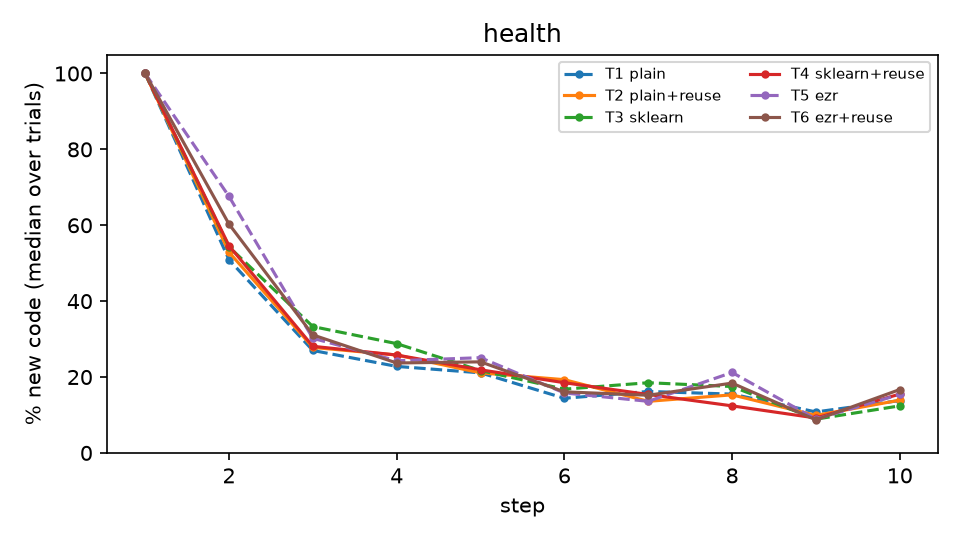
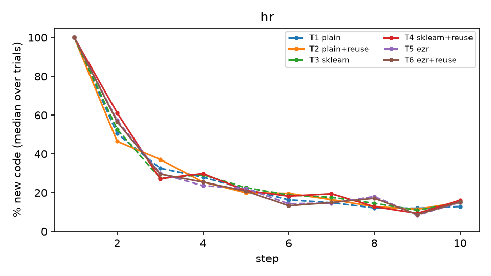
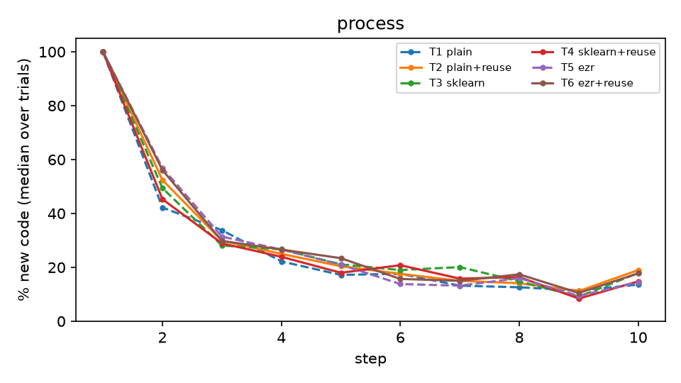

# Results

180 calls logged, 180 scored, up to 1 trials. Generated by `rig/report.py`; do not edit by hand.

In every table a number in brackets is a rank. Rank 0 is the best group. Treatments that share a rank are not distinguishable: `same` (Cliff's delta, Kolmogorov-Smirnov, Cohen at 0.35) could not tell them apart.

**N = 1.** With so few trials per cell `same` has little to work with: at N = 3 the Kolmogorov-Smirnov test can never report a difference. Read per-step ranks as provisional.

## health

60 calls; 60 returned a file; 45 were scored without error (the rest earn the failure value).

### Competency and cost

Competency (lecturer's A23): if a treatment's functions mostly fail, its other numbers say little. 'Beat dumb baseline' counts programs whose Q is above what a no-effort answer earns.

| treatment | programs | demo ran | function worked | beat dumb baseline | new LOC | tokens in | tokens out | cost | clock (min) |
|---|--:|--:|--:|--:|--:|--:|--:|--:|--:|
| T1 plain | 10 | 10 | 9 (90%) | 8 (80%) | 560 | 0.04M | 0.01M | $0.02 | 1 |
| T2 plain+reuse | 10 | 9 | 10 (100%) | 10 (100%) | 538 | 0.04M | 0.01M | $0.02 | 2 |
| T3 sklearn | 10 | 5 | 4 (40%) | 3 (30%) | 566 | 0.04M | 0.01M | $0.02 | 2 |
| T4 sklearn+reuse | 10 | 6 | 4 (40%) | 4 (40%) | 503 | 0.04M | 0.01M | $0.02 | 2 |
| T5 ezr | 10 | 10 | 9 (90%) | 8 (80%) | 423 | 0.09M | 0.01M | $0.03 | 3 |
| T6 ezr+reuse | 10 | 9 | 9 (90%) | 9 (90%) | 414 | 0.09M | 0.01M | $0.03 | 2 |

### New lines of code per step (lower is better)

Median over the trials that returned a file; a blank cell means none did. Few lines is only reuse if Q held up: check the next table.

| treatment | s1 | s2 | s3 | s4 | s5 | s6 | s7 | s8 | s9 | s10 |
|---|--:|--:|--:|--:|--:|--:|--:|--:|--:|--:|
| T1 plain | 57 (5) | 59 (5) | 43 (4) | 47 (2) | 55 (4) | 44 (1) | 59 (4) | 67 (3) | 52 (5) | 77 (4) |
| T2 plain+reuse | 49 (4) | 55 (4) | 40 (3) | 50 (3) | 52 (3) | 59 (4) | 48 (2) | 64 (2) | 46 (4) | 75 (3) |
| T3 sklearn | 43 (2) | 51 (2) | 47 (5) | 57 (4) | 55 (4) | 51 (2) | 69 (5) | 79 (5) | 44 (3) | 70 (2) |
| T4 sklearn+reuse | 44 (3) | 53 (3) | 38 (2) | 47 (2) | 51 (2) | 53 (3) | 52 (3) | 48 (0) | 39 (2) | 78 (5) |
| T5 ezr | 24 (0) | 50 (1) | 32 (0) | 34 (1) | 47 (1) | 35 (0) | 35 (0) | 69 (4) | 32 (1) | 65 (0) |
| T6 ezr+reuse | 29 (1) | 44 (0) | 33 (1) | 33 (0) | 44 (0) | 35 (0) | 39 (1) | 58 (1) | 30 (0) | 69 (1) |

### Per skill, on the test suite (higher is better)

Mean over test cases, pooled over trials, with rank. Every treatment faced the same test cases, built from the held-out 20% of the data. A failed program earns the skill's baseline on every case. This is the table to quote.

| skill | cases | T1 plain | T2 plain+reuse | T3 sklearn | T4 sklearn+reuse | T5 ezr | T6 ezr+reuse |
|---|--:|--:|--:|--:|--:|--:|--:|
| remember | 20 | 0.73 (0) | 0.73 (0) | 0.73 (0) | 0.73 (0) | 0.73 (0) | 0.73 (0) |
| guess | 400 | 0.67 (2) | 0.56 (3) | 0.00 (4) | 0.00 (4) | 0.88 (0) | 0.65 (1) |
| certify | 200 | 0.74 (1) | 0.85 (0) | 0.90 (0) | 0.90 (0) | 0.87 (0) | 0.87 (0) |
| flow | 100 | 0.12 (2) | 0.00 (3) | 0.60 (0) | 0.02 (3) | 0.25 (1) | 0.25 (1) |
| blame | 30 | 0.21 (3) | 0.26 (1) | 0.00 (4) | 0.00 (4) | 0.28 (0) | 0.24 (2) |
| justify | 20 | 0.49 (2) | 0.83 (0) | -1.00 (4) | 0.00 (3) | 0.49 (1) | 0.49 (1) |
| choose | 30 | 0.53 (0) | 0.03 (1) | 0.00 (1) | 0.00 (1) | 0.03 (1) | 0.03 (1) |
| fix | 20 | 0.00 (1) | 1.00 (0) | 0.00 (1) | 1.00 (0) | 0.00 (1) | 1.00 (0) |
| fix: helps | 20 | 0.00 (1) | 0.65 (0) | 0.00 (1) | 0.65 (0) | 0.00 (1) | 0.65 (0) |
| spot | 10 | 0.20 (0) | 0.14 (1) | 0.00 (3) | 0.00 (3) | 0.12 (1) | 0.05 (2) |
| race | 30 | 0.00 (1) | 0.43 (0) | 0.00 (1) | 0.00 (1) | 0.00 (1) | 0.00 (1) |

### Q per step (higher is better)

Each step is a different skill with its own scale, so compare down a column, not along a row.

| treatment | s1 | s2 | s3 | s4 | s5 | s6 | s7 | s8 | s9 | s10 |
|---|--:|--:|--:|--:|--:|--:|--:|--:|--:|--:|
| T1 plain | 0.73 (0) | 0.67 (1) | 0.74 (3) | 0.12 (3) | 0.21 (3) | 0.49 (2) | 0.53 (0) | 0.00 (1) | 0.20 (0) | 0.00 (1) |
| T2 plain+reuse | 0.73 (2) | 0.56 (3) | 0.85 (2) | 0.00 (5) | 0.26 (1) | 0.83 (0) | 0.03 (1) | 1.00 (0) | 0.14 (1) | 0.43 (0) |
| T3 sklearn | 0.73 (2) | 0.00 (4) | 0.90 (0) | 0.60 (0) | 0.00 (4) | -1.00 (4) | 0.00 (2) | 0.00 (1) | 0.00 (4) | 0.00 (1) |
| T4 sklearn+reuse | 0.73 (2) | 0.00 (4) | 0.90 (0) | 0.02 (4) | 0.00 (4) | 0.00 (3) | 0.00 (2) | 1.00 (0) | 0.00 (4) | 0.00 (1) |
| T5 ezr | 0.73 (1) | 0.88 (0) | 0.87 (1) | 0.25 (1) | 0.28 (0) | 0.49 (1) | 0.03 (1) | 0.00 (1) | 0.12 (2) | 0.00 (1) |
| T6 ezr+reuse | 0.73 (1) | 0.65 (2) | 0.87 (1) | 0.25 (2) | 0.24 (2) | 0.49 (1) | 0.03 (1) | 1.00 (0) | 0.05 (3) | 0.00 (1) |

### Over all steps

New lines:

| treatment | n | median | sd | rank |
|---|--:|--:|--:|--:|
| T5 ezr | 10 | 35 | 14 | 0 |
| T6 ezr+reuse | 10 | 37 | 12 | 0 |
| T4 sklearn+reuse | 10 | 50 | 11 | 1 |
| T1 plain | 10 | 56 | 10 | 2 |
| T2 plain+reuse | 10 | 51 | 10 | 2 |
| T3 sklearn | 10 | 53 | 12 | 2 |

Z (Q rescaled within each skill; higher is better):

| treatment | n | median | sd | rank |
|---|--:|--:|--:|--:|
| T1 plain | 10 | 0.41 | 1.26 | 0 |
| T2 plain+reuse | 10 | 0.51 | 0.95 | 0 |
| T5 ezr | 10 | 0.39 | 0.65 | 0 |
| T6 ezr+reuse | 10 | 0.39 | 0.49 | 0 |
| T3 sklearn | 10 | -0.97 | 1.11 | 1 |
| T4 sklearn+reuse | 10 | -0.74 | 0.79 | 1 |

## hr

60 calls; 60 returned a file; 45 were scored without error (the rest earn the failure value).

### Competency and cost

Competency (lecturer's A23): if a treatment's functions mostly fail, its other numbers say little. 'Beat dumb baseline' counts programs whose Q is above what a no-effort answer earns.

| treatment | programs | demo ran | function worked | beat dumb baseline | new LOC | tokens in | tokens out | cost | clock (min) |
|---|--:|--:|--:|--:|--:|--:|--:|--:|--:|
| T1 plain | 10 | 10 | 9 (90%) | 8 (80%) | 534 | 0.04M | 0.01M | $0.02 | 1 |
| T2 plain+reuse | 10 | 9 | 8 (80%) | 6 (60%) | 521 | 0.04M | 0.01M | $0.02 | 1 |
| T3 sklearn | 10 | 7 | 5 (50%) | 5 (50%) | 429 | 0.04M | 0.01M | $0.02 | 1 |
| T4 sklearn+reuse | 10 | 6 | 7 (70%) | 6 (60%) | 380 | 0.03M | 0.01M | $0.02 | 1 |
| T5 ezr | 10 | 9 | 8 (80%) | 6 (60%) | 386 | 0.09M | 0.01M | $0.03 | 1 |
| T6 ezr+reuse | 10 | 9 | 8 (80%) | 6 (60%) | 387 | 0.09M | 0.01M | $0.03 | 1 |

### New lines of code per step (lower is better)

Median over the trials that returned a file; a blank cell means none did. Few lines is only reuse if Q held up: check the next table.

| treatment | s1 | s2 | s3 | s4 | s5 | s6 | s7 | s8 | s9 | s10 |
|---|--:|--:|--:|--:|--:|--:|--:|--:|--:|--:|
| T1 plain | 48 (5) | 49 (4) | 47 (3) | 56 (5) | 56 (5) | 50 (4) | 53 (3) | 50 (2) | 56 (5) | 69 (4) |
| T2 plain+reuse | 46 (4) | 40 (1) | 51 (4) | 47 (4) | 46 (4) | 56 (5) | 56 (4) | 50 (2) | 51 (4) | 78 (5) |
| T3 sklearn | 35 (3) | 39 (0) | 28 (1) | 42 (3) | 42 (3) | 43 (3) | 49 (2) | 47 (1) | 40 (3) | 64 (3) |
| T4 sklearn+reuse | 26 (0) | 41 (2) | 25 (0) | 39 (2) | 35 (0) | 37 (2) | 49 (2) | 37 (0) | 30 (2) | 61 (2) |
| T5 ezr | 32 (1) | 43 (3) | 32 (2) | 33 (0) | 40 (2) | 30 (1) | 36 (0) | 54 (4) | 28 (0) | 58 (0) |
| T6 ezr+reuse | 33 (2) | 43 (3) | 32 (2) | 37 (1) | 38 (1) | 28 (0) | 37 (1) | 51 (3) | 29 (1) | 59 (1) |

### Per skill, on the test suite (higher is better)

Mean over test cases, pooled over trials, with rank. Every treatment faced the same test cases, built from the held-out 20% of the data. A failed program earns the skill's baseline on every case. This is the table to quote.

| skill | cases | T1 plain | T2 plain+reuse | T3 sklearn | T4 sklearn+reuse | T5 ezr | T6 ezr+reuse |
|---|--:|--:|--:|--:|--:|--:|--:|
| remember | 14 | 0.45 (2) | 0.45 (2) | 0.54 (0) | 0.44 (2) | 0.53 (0) | 0.50 (1) |
| guess | 294 | 0.14 (1) | 0.14 (1) | 0.00 (2) | 0.00 (2) | 0.61 (0) | 0.61 (0) |
| certify | 200 | 0.87 (0) | 0.50 (1) | 0.88 (0) | 0.88 (0) | 0.81 (0) | 0.81 (0) |
| flow | 100 | 0.18 (2) | -0.21 (5) | 0.10 (3) | -0.02 (4) | 0.26 (1) | 0.43 (0) |
| blame | 30 | 0.03 (1) | 0.01 (2) | 0.00 (3) | 0.00 (3) | 0.07 (0) | 0.07 (0) |
| justify | 20 | -1.00 (4) | -1.00 (4) | 0.28 (1) | 0.27 (2) | -0.72 (3) | 0.63 (0) |
| choose | 30 | 0.33 (0) | 0.25 (0) | 0.00 (2) | 0.10 (1) | 0.00 (2) | 0.00 (2) |
| fix | 20 | 1.00 (0) | 0.55 (1) | 1.00 (0) | 0.55 (1) | 0.00 (2) | 0.00 (2) |
| fix: helps | 20 | 0.60 (0) | 0.30 (1) | 0.55 (0) | 0.30 (1) | 0.00 (2) | 0.00 (2) |
| spot | 10 | 0.50 (0) | 0.50 (0) | 0.00 (2) | 0.00 (2) | 0.01 (1) | 0.00 (2) |
| race | 30 | 0.00 (1) | 0.00 (1) | 0.00 (1) | 0.42 (0) | 0.00 (1) | 0.00 (1) |

### Q per step (higher is better)

Each step is a different skill with its own scale, so compare down a column, not along a row.

| treatment | s1 | s2 | s3 | s4 | s5 | s6 | s7 | s8 | s9 | s10 |
|---|--:|--:|--:|--:|--:|--:|--:|--:|--:|--:|
| T1 plain | 0.45 (3) | 0.14 (1) | 0.87 (1) | 0.18 (2) | 0.03 (2) | -1.00 (4) | 0.33 (0) | 1.00 (0) | 0.50 (0) | 0.00 (1) |
| T2 plain+reuse | 0.45 (3) | 0.14 (1) | 0.50 (3) | -0.21 (5) | 0.01 (3) | -1.00 (4) | 0.25 (1) | 0.55 (1) | 0.50 (0) | 0.00 (1) |
| T3 sklearn | 0.54 (0) | 0.00 (2) | 0.88 (0) | 0.10 (3) | 0.00 (4) | 0.28 (1) | 0.00 (3) | 1.00 (0) | 0.00 (2) | 0.00 (1) |
| T4 sklearn+reuse | 0.44 (4) | 0.00 (2) | 0.88 (0) | -0.02 (4) | 0.00 (4) | 0.27 (2) | 0.10 (2) | 0.55 (1) | 0.00 (2) | 0.42 (0) |
| T5 ezr | 0.53 (1) | 0.61 (0) | 0.81 (2) | 0.26 (1) | 0.07 (0) | -0.72 (3) | 0.00 (3) | 0.00 (2) | 0.01 (1) | 0.00 (1) |
| T6 ezr+reuse | 0.50 (2) | 0.61 (0) | 0.81 (2) | 0.43 (0) | 0.07 (1) | 0.63 (0) | 0.00 (3) | 0.00 (2) | 0.00 (2) | 0.00 (1) |

### Over all steps

New lines:

| treatment | n | median | sd | rank |
|---|--:|--:|--:|--:|
| T4 sklearn+reuse | 10 | 37 | 10 | 0 |
| T5 ezr | 10 | 34 | 10 | 0 |
| T6 ezr+reuse | 10 | 37 | 9 | 0 |
| T3 sklearn | 10 | 42 | 9 | 1 |
| T2 plain+reuse | 10 | 50 | 10 | 2 |
| T1 plain | 10 | 52 | 6 | 3 |

Z (Q rescaled within each skill; higher is better):

| treatment | n | median | sd | rank |
|---|--:|--:|--:|--:|
| T1 plain | 10 | 0.21 | 0.91 | 0 |
| T5 ezr | 10 | -0.14 | 0.94 | 0 |
| T6 ezr+reuse | 10 | 0.26 | 1.00 | 0 |
| T3 sklearn | 10 | -0.29 | 0.87 | 1 |
| T4 sklearn+reuse | 10 | -0.41 | 1.01 | 1 |
| T2 plain+reuse | 10 | -0.62 | 1.05 | 2 |

## process

60 calls; 60 returned a file; 48 were scored without error (the rest earn the failure value).

### Competency and cost

Competency (lecturer's A23): if a treatment's functions mostly fail, its other numbers say little. 'Beat dumb baseline' counts programs whose Q is above what a no-effort answer earns.

| treatment | programs | demo ran | function worked | beat dumb baseline | new LOC | tokens in | tokens out | cost | clock (min) |
|---|--:|--:|--:|--:|--:|--:|--:|--:|--:|
| T1 plain | 10 | 10 | 9 (90%) | 9 (90%) | 499 | 0.04M | 0.01M | $0.02 | 3 |
| T2 plain+reuse | 10 | 10 | 9 (90%) | 9 (90%) | 453 | 0.04M | 0.01M | $0.02 | 2 |
| T3 sklearn | 10 | 8 | 7 (70%) | 7 (70%) | 508 | 0.04M | 0.01M | $0.02 | 5 |
| T4 sklearn+reuse | 10 | 9 | 8 (80%) | 6 (60%) | 446 | 0.04M | 0.01M | $0.02 | 2 |
| T5 ezr | 10 | 10 | 8 (80%) | 6 (60%) | 372 | 0.09M | 0.01M | $0.03 | 3 |
| T6 ezr+reuse | 10 | 6 | 7 (70%) | 6 (60%) | 383 | 0.09M | 0.01M | $0.03 | 6 |

### New lines of code per step (lower is better)

Median over the trials that returned a file; a blank cell means none did. Few lines is only reuse if Q held up: check the next table.

| treatment | s1 | s2 | s3 | s4 | s5 | s6 | s7 | s8 | s9 | s10 |
|---|--:|--:|--:|--:|--:|--:|--:|--:|--:|--:|
| T1 plain | 59 (5) | 43 (3) | 52 (4) | 44 (3) | 41 (4) | 51 (4) | 44 (3) | 48 (1) | 49 (5) | 68 (2) |
| T2 plain+reuse | 39 (2) | 43 (3) | 35 (3) | 39 (2) | 40 (3) | 42 (2) | 42 (2) | 46 (0) | 41 (4) | 86 (3) |
| T3 sklearn | 44 (3) | 43 (3) | 34 (2) | 44 (3) | 44 (5) | 49 (3) | 65 (5) | 56 (3) | 38 (3) | 91 (4) |
| T4 sklearn+reuse | 47 (4) | 39 (1) | 35 (3) | 38 (1) | 35 (0) | 51 (4) | 46 (4) | 57 (4) | 32 (1) | 66 (1) |
| T5 ezr | 31 (1) | 41 (2) | 33 (1) | 38 (1) | 38 (1) | 29 (0) | 32 (0) | 46 (0) | 30 (0) | 54 (0) |
| T6 ezr+reuse | 29 (0) | 37 (0) | 28 (0) | 34 (0) | 39 (2) | 31 (1) | 35 (1) | 49 (2) | 33 (2) | 68 (2) |

### Per skill, on the test suite (higher is better)

Mean over test cases, pooled over trials, with rank. Every treatment faced the same test cases, built from the held-out 20% of the data. A failed program earns the skill's baseline on every case. This is the table to quote.

| skill | cases | T1 plain | T2 plain+reuse | T3 sklearn | T4 sklearn+reuse | T5 ezr | T6 ezr+reuse |
|---|--:|--:|--:|--:|--:|--:|--:|
| remember | 20 | 0.69 (0) | 0.69 (0) | 0.69 (0) | 0.69 (0) | 0.68 (0) | 0.68 (0) |
| guess | 400 | 0.42 (1) | 0.42 (1) | 0.58 (0) | 0.58 (0) | 0.43 (1) | 0.43 (1) |
| certify | 200 | 0.78 (0) | 0.69 (1) | 0.86 (0) | 0.86 (0) | 0.81 (0) | 0.81 (0) |
| flow | 100 | 0.08 (0) | 0.08 (0) | 0.08 (0) | -0.07 (1) | -0.07 (1) | -0.07 (1) |
| blame | 30 | 0.04 (1) | 0.04 (1) | 0.02 (1) | 0.00 (2) | 0.08 (0) | 0.08 (0) |
| justify | 20 | 0.13 (1) | 0.07 (1) | 0.10 (2) | 0.02 (3) | 0.40 (0) | 0.00 (4) |
| choose | 30 | 0.43 (0) | 0.57 (0) | 0.00 (1) | 0.57 (0) | 0.00 (1) | 0.00 (1) |
| fix | 20 | 1.00 (0) | 1.00 (0) | 1.00 (0) | 0.00 (1) | 0.00 (1) | 1.00 (0) |
| fix: helps | 20 | 0.55 (0) | 0.55 (0) | 0.55 (0) | 0.00 (1) | 0.00 (1) | 0.65 (0) |
| spot | 10 | 0.20 (0) | 0.20 (0) | 0.00 (3) | 0.00 (3) | 0.03 (1) | 0.01 (2) |
| race | 30 | 0.00 (0) | 0.00 (0) | 0.00 (0) | 0.00 (0) | 0.00 (0) | 0.00 (0) |

### Q per step (higher is better)

Each step is a different skill with its own scale, so compare down a column, not along a row.

| treatment | s1 | s2 | s3 | s4 | s5 | s6 | s7 | s8 | s9 | s10 |
|---|--:|--:|--:|--:|--:|--:|--:|--:|--:|--:|
| T1 plain | 0.69 (1) | 0.42 (2) | 0.78 (2) | 0.08 (0) | 0.04 (1) | 0.13 (1) | 0.43 (1) | 1.00 (0) | 0.20 (0) | 0.00 (0) |
| T2 plain+reuse | 0.69 (0) | 0.42 (2) | 0.69 (3) | 0.08 (0) | 0.04 (1) | 0.07 (3) | 0.57 (0) | 1.00 (0) | 0.20 (0) | 0.00 (0) |
| T3 sklearn | 0.69 (1) | 0.58 (0) | 0.86 (0) | 0.08 (0) | 0.02 (2) | 0.10 (2) | 0.00 (2) | 1.00 (0) | 0.00 (3) | 0.00 (0) |
| T4 sklearn+reuse | 0.69 (1) | 0.58 (0) | 0.86 (0) | -0.07 (1) | 0.00 (3) | 0.02 (4) | 0.57 (0) | 0.00 (1) | 0.00 (3) | 0.00 (0) |
| T5 ezr | 0.68 (2) | 0.43 (1) | 0.81 (1) | -0.07 (1) | 0.08 (0) | 0.40 (0) | 0.00 (2) | 0.00 (1) | 0.03 (1) | 0.00 (0) |
| T6 ezr+reuse | 0.68 (2) | 0.43 (1) | 0.81 (1) | -0.07 (1) | 0.08 (0) | 0.00 (5) | 0.00 (2) | 1.00 (0) | 0.01 (2) | 0.00 (0) |

### Over all steps

New lines:

| treatment | n | median | sd | rank |
|---|--:|--:|--:|--:|
| T5 ezr | 10 | 36 | 8 | 0 |
| T6 ezr+reuse | 10 | 34 | 11 | 0 |
| T2 plain+reuse | 10 | 42 | 14 | 1 |
| T3 sklearn | 10 | 44 | 16 | 2 |
| T4 sklearn+reuse | 10 | 42 | 10 | 3 |
| T1 plain | 10 | 48 | 8 | 4 |

Z (Q rescaled within each skill; higher is better):

| treatment | n | median | sd | rank |
|---|--:|--:|--:|--:|
| T1 plain | 10 | 0.21 | 0.63 | 0 |
| T2 plain+reuse | 10 | 0.35 | 1.05 | 0 |
| T3 sklearn | 10 | 0.16 | 0.82 | 0 |
| T4 sklearn+reuse | 10 | -0.39 | 1.03 | 1 |
| T5 ezr | 10 | -0.58 | 1.08 | 1 |
| T6 ezr+reuse | 10 | -0.69 | 0.79 | 1 |

## All domains together

### Competency and cost

| treatment | programs | demo ran | function worked | beat dumb baseline | new LOC | tokens in | tokens out | cost | clock (min) |
|---|--:|--:|--:|--:|--:|--:|--:|--:|--:|
| T1 plain | 30 | 30 | 27 (90%) | 25 (83%) | 1593 | 0.12M | 0.02M | $0.06 | 6 |
| T2 plain+reuse | 30 | 28 | 27 (90%) | 25 (83%) | 1512 | 0.11M | 0.02M | $0.06 | 4 |
| T3 sklearn | 30 | 20 | 16 (53%) | 15 (50%) | 1503 | 0.12M | 0.02M | $0.06 | 8 |
| T4 sklearn+reuse | 30 | 21 | 19 (63%) | 16 (53%) | 1329 | 0.11M | 0.02M | $0.06 | 6 |
| T5 ezr | 30 | 29 | 25 (83%) | 20 (66%) | 1181 | 0.27M | 0.02M | $0.10 | 8 |
| T6 ezr+reuse | 30 | 24 | 24 (80%) | 21 (70%) | 1184 | 0.27M | 0.02M | $0.09 | 9 |

Z is computed within each (domain, skill), then pooled.

| treatment | n | median | sd | rank |
|---|--:|--:|--:|--:|
| T1 plain | 30 | 0.31 | 0.97 | 0 |
| T2 plain+reuse | 30 | -0.02 | 1.09 | 0 |
| T5 ezr | 30 | 0.08 | 0.93 | 0 |
| T6 ezr+reuse | 30 | 0.18 | 0.84 | 0 |
| T3 sklearn | 30 | -0.45 | 1.00 | 1 |
| T4 sklearn+reuse | 30 | -0.63 | 0.97 | 1 |

New lines, pooled:

| treatment | n | median | sd | rank |
|---|--:|--:|--:|--:|
| T5 ezr | 30 | 35 | 11 | 0 |
| T6 ezr+reuse | 30 | 36 | 11 | 0 |
| T4 sklearn+reuse | 30 | 42 | 12 | 1 |
| T2 plain+reuse | 30 | 48 | 12 | 2 |
| T3 sklearn | 30 | 46 | 14 | 2 |
| T1 plain | 30 | 52 | 9 | 3 |
