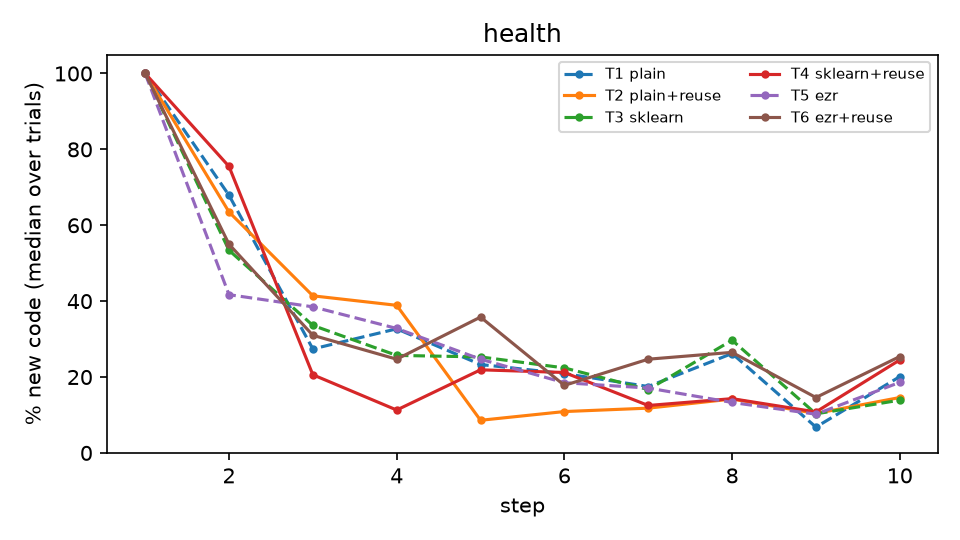

# Results

180 calls logged, 180 scored, up to 1 trials. Generated by `rig/report.py`; do not edit by hand.

In every table a number in brackets is a rank. Rank 0 is the best group. Treatments that share a rank are not distinguishable: `same` (Cliff's delta, Kolmogorov-Smirnov, Cohen at 0.35) could not tell them apart.

**N = 1.** With so few trials per cell `same` has little to work with: at N = 3 the Kolmogorov-Smirnov test can never report a difference. Read per-step ranks as provisional.

## health

60 calls; 60 returned a file; 24 were scored without error (the rest earn the failure value).

### New lines of code per step (lower is better)

Median over the trials that returned a file; a blank cell means none did. Few lines is only reuse if Q held up: check the next table.

| treatment | s1 | s2 | s3 | s4 | s5 | s6 | s7 | s8 | s9 | s10 |
|---|--:|--:|--:|--:|--:|--:|--:|--:|--:|--:|
| T1 plain | 34 (2) | 72 (3) | 40 (3) | 71 (3) | 66 (5) | 75 (5) | 76 (5) | 154 (5) | 43 (1) | 159 (4) |
| T2 plain+reuse | 46 (4) | 80 (4) | 89 (4) | 137 (4) | 33 (0) | 47 (2) | 58 (4) | 81 (3) | 66 (5) | 109 (3) |
| T3 sklearn | 34 (2) | 39 (2) | 37 (2) | 38 (2) | 50 (3) | 57 (3) | 51 (3) | 129 (4) | 50 (3) | 78 (1) |
| T4 sklearn+reuse | 35 (3) | 108 (5) | 37 (2) | 23 (1) | 57 (4) | 70 (4) | 47 (1) | 63 (1) | 53 (4) | 160 (5) |
| T5 ezr | 28 (1) | 20 (0) | 30 (1) | 38 (2) | 38 (1) | 35 (1) | 39 (0) | 35 (0) | 30 (0) | 67 (0) |
| T6 ezr+reuse | 18 (0) | 22 (1) | 18 (0) | 19 (0) | 43 (2) | 26 (0) | 48 (2) | 70 (2) | 45 (2) | 105 (2) |

### Per skill, on the test suite (higher is better)

Mean over test cases, pooled over trials, with rank. Every treatment faced the same test cases, built from the held-out 20% of the data. A failed program earns the skill's baseline on every case. This is the table to quote.

| skill | cases | T1 plain | T2 plain+reuse | T3 sklearn | T4 sklearn+reuse | T5 ezr | T6 ezr+reuse |
|---|--:|--:|--:|--:|--:|--:|--:|
| remember | 20 | 0.73 (0) | 0.07 (2) | 0.73 (0) | 0.73 (0) | 0.00 (1) | 0.73 (0) |
| guess | 400 | 0.00 (1) | 0.00 (1) | 0.00 (1) | 0.00 (1) | 0.00 (1) | -0.05 (0) |
| certify | 200 | 0.91 (0) | 0.50 (1) | 0.52 (1) | 0.50 (1) | 0.50 (1) | 0.87 (0) |
| flow | 100 | -0.06 (2) | 0.00 (0) | 0.00 (0) | 0.00 (0) | 0.00 (0) | 0.02 (1) |
| blame | 30 | 0.00 (1) | 0.20 (0) | 0.00 (1) | 0.00 (1) | 0.00 (1) | 0.00 (1) |
| justify | 20 | -1.00 (2) | 0.00 (1) | 0.00 (1) | 0.00 (1) | 0.00 (1) | 0.87 (0) |
| choose | 30 | 0.03 (0) | 0.00 (0) | 0.00 (0) | 0.00 (0) | 0.00 (0) | 0.00 (0) |
| fix | 20 | 0.00 (1) | 1.00 (0) | 0.00 (1) | 0.00 (1) | 0.00 (1) | 0.00 (1) |
| fix: helps | 20 | 0.00 (1) | 0.35 (0) | 0.00 (1) | 0.00 (1) | 0.00 (1) | 0.00 (1) |
| spot | 10 | 0.50 (0) | 0.50 (0) | 0.00 (1) | 0.00 (1) | 0.00 (1) | 0.00 (1) |
| race | 30 | 0.00 (0) | 0.00 (0) | 0.00 (0) | 0.00 (0) | 0.00 (0) | 0.00 (0) |

### Q per step (higher is better)

Each step is a different skill with its own scale, so compare down a column, not along a row.

| treatment | s1 | s2 | s3 | s4 | s5 | s6 | s7 | s8 | s9 | s10 |
|---|--:|--:|--:|--:|--:|--:|--:|--:|--:|--:|
| T1 plain | 0.73 (1) | 0.00 (0) | 0.91 (0) | -0.06 (2) | 0.00 (1) | -1.00 (2) | 0.03 (0) | 0.00 (1) | 0.50 (0) | 0.00 (0) |
| T2 plain+reuse | 0.07 (3) | 0.00 (0) | 0.50 (3) | 0.00 (1) | 0.20 (0) | 0.00 (1) | 0.00 (1) | 1.00 (0) | 0.50 (0) | 0.00 (0) |
| T3 sklearn | 0.73 (2) | 0.00 (0) | 0.52 (2) | 0.00 (1) | 0.00 (1) | 0.00 (1) | 0.00 (1) | 0.00 (1) | 0.00 (1) | 0.00 (0) |
| T4 sklearn+reuse | 0.73 (1) | 0.00 (0) | 0.50 (3) | 0.00 (1) | 0.00 (1) | 0.00 (1) | 0.00 (1) | 0.00 (1) | 0.00 (1) | 0.00 (0) |
| T5 ezr | 0.00 (4) | 0.00 (0) | 0.50 (3) | 0.00 (1) | 0.00 (1) | 0.00 (1) | 0.00 (1) | 0.00 (1) | 0.00 (1) | 0.00 (0) |
| T6 ezr+reuse | 0.73 (0) | -0.05 (1) | 0.87 (1) | 0.02 (0) | 0.00 (1) | 0.87 (0) | 0.00 (1) | 0.00 (1) | 0.00 (1) | 0.00 (0) |

### Over all steps

New lines:

| treatment | n | median | sd | rank |
|---|--:|--:|--:|--:|
| T5 ezr | 10 | 35 | 12 | 0 |
| T6 ezr+reuse | 10 | 34 | 27 | 0 |
| T3 sklearn | 10 | 50 | 27 | 1 |
| T4 sklearn+reuse | 10 | 55 | 39 | 1 |
| T1 plain | 10 | 72 | 41 | 2 |
| T2 plain+reuse | 10 | 73 | 30 | 2 |

Z (Q rescaled within each skill; higher is better):

| treatment | n | median | sd | rank |
|---|--:|--:|--:|--:|
| T1 plain | 10 | 0.22 | 1.34 | 0 |
| T2 plain+reuse | 10 | 0.15 | 1.14 | 0 |
| T6 ezr+reuse | 10 | -0.22 | 1.10 | 0 |
| T3 sklearn | 10 | -0.22 | 0.46 | 1 |
| T4 sklearn+reuse | 10 | -0.22 | 0.47 | 1 |
| T5 ezr | 10 | -0.45 | 0.54 | 2 |

## hr

60 calls; 59 returned a file; 21 were scored without error (the rest earn the failure value).

### New lines of code per step (lower is better)

Median over the trials that returned a file; a blank cell means none did. Few lines is only reuse if Q held up: check the next table.

| treatment | s1 | s2 | s3 | s4 | s5 | s6 | s7 | s8 | s9 | s10 |
|---|--:|--:|--:|--:|--:|--:|--:|--:|--:|--:|
| T1 plain | 22 (0) | 80 (3) | 30 (3) | 24 (0) | 42 (2) | 25 (1) | 56 (5) | 66 (0) | 44 (2) | 78 (1) |
| T2 plain+reuse | 39 (3) | 62 (2) | 60 (5) | 31 (1) | 45 (3) | 53 (4) | 41 (3) | 98 (3) | 58 (3) | 195 (3) |
| T3 sklearn | 34 (2) | 52 (1) | 34 (4) | 42 (3) | 51 (4) | 50 (3) | 53 (4) | 84 (1) | 76 (4) | 138 (2) |
| T4 sklearn+reuse | 42 (4) | 30 (0) | 19 (2) | 43 (4) | 61 (5) | 63 (5) | 32 (1) | 100 (4) | 58 (3) |  |
| T5 ezr | 30 (1) | 139 (5) | 17 (1) | 33 (2) | 30 (0) | 29 (2) | 39 (2) | 85 (2) | 32 (1) | 71 (0) |
| T6 ezr+reuse | 54 (5) | 81 (4) | 16 (0) | 24 (0) | 35 (1) | 20 (0) | 29 (0) | 66 (0) | 26 (0) | 211 (4) |

### Per skill, on the test suite (higher is better)

Mean over test cases, pooled over trials, with rank. Every treatment faced the same test cases, built from the held-out 20% of the data. A failed program earns the skill's baseline on every case. This is the table to quote.

| skill | cases | T1 plain | T2 plain+reuse | T3 sklearn | T4 sklearn+reuse | T5 ezr | T6 ezr+reuse |
|---|--:|--:|--:|--:|--:|--:|--:|
| remember | 14 | 0.00 (1) | 0.54 (0) | 0.54 (0) | 0.00 (1) | -0.19 (2) | 0.00 (1) |
| guess | 294 | 0.00 (0) | 0.00 (0) | 0.00 (0) | 0.00 (0) | 0.00 (0) | 0.00 (0) |
| certify | 200 | 0.67 (1) | 0.88 (0) | 0.51 (2) | 0.50 (3) | 0.50 (3) | 0.83 (0) |
| flow | 100 | -0.17 (2) | 0.00 (1) | 0.11 (0) | 0.00 (1) | -0.13 (2) | 0.00 (1) |
| blame | 30 | 0.00 (2) | 0.00 (2) | 0.00 (2) | 0.00 (2) | 0.01 (1) | 0.05 (0) |
| justify | 20 | 0.00 (1) | 0.00 (1) | 0.00 (1) | 0.00 (1) | 0.63 (0) | -0.72 (2) |
| choose | 30 | 0.18 (0) | 0.00 (1) | 0.00 (1) | 0.00 (1) | 0.00 (1) | 0.00 (1) |
| fix | 20 | 0.00 (1) | 0.00 (1) | 0.00 (1) | 0.00 (1) | 1.00 (0) | 0.00 (1) |
| fix: helps | 20 | 0.00 (1) | 0.00 (1) | 0.00 (1) | 0.00 (1) | 0.40 (0) | 0.00 (1) |
| spot | 10 | 0.00 (3) | 0.02 (1) | 0.00 (3) | 0.00 (3) | 0.01 (2) | 0.25 (0) |
| race | 30 | 0.00 (0) | 0.00 (0) | 0.00 (0) | 0.00 (0) | 0.00 (0) | 0.00 (0) |

### Q per step (higher is better)

Each step is a different skill with its own scale, so compare down a column, not along a row.

| treatment | s1 | s2 | s3 | s4 | s5 | s6 | s7 | s8 | s9 | s10 |
|---|--:|--:|--:|--:|--:|--:|--:|--:|--:|--:|
| T1 plain | 0.00 (1) | 0.00 (0) | 0.67 (2) | -0.17 (3) | 0.00 (2) | 0.00 (1) | 0.18 (0) | 0.00 (1) | 0.00 (3) | 0.00 (0) |
| T2 plain+reuse | 0.54 (0) | 0.00 (0) | 0.88 (0) | 0.00 (1) | 0.00 (2) | 0.00 (1) | 0.00 (1) | 0.00 (1) | 0.02 (1) | 0.00 (0) |
| T3 sklearn | 0.54 (0) | 0.00 (0) | 0.51 (3) | 0.11 (0) | 0.00 (2) | 0.00 (1) | 0.00 (1) | 0.00 (1) | 0.00 (3) | 0.00 (0) |
| T4 sklearn+reuse | 0.00 (1) | 0.00 (0) | 0.50 (4) | 0.00 (1) | 0.00 (2) | 0.00 (1) | 0.00 (1) | 0.00 (1) | 0.00 (3) | 0.00 (0) |
| T5 ezr | -0.19 (2) | 0.00 (0) | 0.50 (4) | -0.13 (2) | 0.01 (1) | 0.63 (0) | 0.00 (1) | 1.00 (0) | 0.01 (2) | 0.00 (0) |
| T6 ezr+reuse | 0.00 (1) | 0.00 (0) | 0.83 (1) | 0.00 (1) | 0.05 (0) | -0.72 (2) | 0.00 (1) | 0.00 (1) | 0.25 (0) | 0.00 (0) |

### Over all steps

New lines:

| treatment | n | median | sd | rank |
|---|--:|--:|--:|--:|
| T1 plain | 10 | 43 | 21 | 0 |
| T4 sklearn+reuse | 9 | 43 | 23 | 0 |
| T5 ezr | 10 | 32 | 36 | 0 |
| T6 ezr+reuse | 10 | 32 | 55 | 0 |
| T2 plain+reuse | 10 | 56 | 46 | 1 |
| T3 sklearn | 10 | 52 | 30 | 1 |

Z (Q rescaled within each skill; higher is better):

| treatment | n | median | sd | rank |
|---|--:|--:|--:|--:|
| T1 plain | 10 | -0.22 | 0.90 | 0 |
| T2 plain+reuse | 10 | 0.00 | 0.68 | 0 |
| T3 sklearn | 10 | -0.22 | 0.77 | 0 |
| T5 ezr | 10 | -0.24 | 1.08 | 0 |
| T6 ezr+reuse | 10 | 0.00 | 1.20 | 0 |
| T4 sklearn+reuse | 10 | -0.45 | 0.36 | 1 |

## process

60 calls; 59 returned a file; 36 were scored without error (the rest earn the failure value).

### New lines of code per step (lower is better)

Median over the trials that returned a file; a blank cell means none did. Few lines is only reuse if Q held up: check the next table.

| treatment | s1 | s2 | s3 | s4 | s5 | s6 | s7 | s8 | s9 | s10 |
|---|--:|--:|--:|--:|--:|--:|--:|--:|--:|--:|
| T1 plain | 40 (2) | 70 (4) | 73 (4) | 54 (3) | 61 (4) | 52 (3) | 37 (2) | 106 (4) | 65 (4) |  |
| T2 plain+reuse | 34 (1) | 57 (2) | 49 (3) | 62 (4) | 46 (1) | 69 (4) | 25 (0) | 113 (5) | 58 (3) | 81 (1) |
| T3 sklearn | 50 (3) | 56 (1) | 34 (1) | 46 (1) | 59 (3) | 88 (5) | 54 (5) | 39 (1) | 51 (2) | 179 (4) |
| T4 sklearn+reuse | 56 (5) | 74 (5) | 47 (2) | 53 (2) | 59 (3) | 48 (2) | 42 (3) | 93 (3) | 89 (5) | 75 (0) |
| T5 ezr | 21 (0) | 40 (0) | 24 (0) | 46 (1) | 38 (0) | 27 (0) | 33 (1) | 71 (2) | 29 (0) | 143 (3) |
| T6 ezr+reuse | 53 (4) | 69 (3) | 34 (1) | 41 (0) | 48 (2) | 35 (1) | 49 (4) | 29 (0) | 33 (1) | 104 (2) |

### Per skill, on the test suite (higher is better)

Mean over test cases, pooled over trials, with rank. Every treatment faced the same test cases, built from the held-out 20% of the data. A failed program earns the skill's baseline on every case. This is the table to quote.

| skill | cases | T1 plain | T2 plain+reuse | T3 sklearn | T4 sklearn+reuse | T5 ezr | T6 ezr+reuse |
|---|--:|--:|--:|--:|--:|--:|--:|
| remember | 20 | 0.69 (0) | 0.69 (0) | 0.69 (0) | 0.69 (0) | 0.68 (0) | 0.00 (1) |
| guess | 400 | -1.00 (4) | -0.23 (2) | 0.00 (1) | 0.53 (0) | -0.71 (3) | 0.00 (1) |
| certify | 200 | 0.86 (0) | 0.67 (1) | 0.51 (2) | 0.57 (1) | 0.81 (0) | 0.81 (0) |
| flow | 100 | -0.07 (1) | -0.07 (1) | -0.07 (1) | 0.00 (0) | 0.00 (0) | -0.07 (1) |
| blame | 30 | 0.00 (3) | 0.16 (0) | 0.04 (2) | 0.11 (1) | 0.16 (0) | 0.00 (3) |
| justify | 20 | 0.69 (0) | -0.42 (3) | 0.00 (2) | 0.69 (0) | 0.40 (1) | 0.00 (2) |
| choose | 30 | 0.00 (0) | 0.00 (0) | 0.02 (0) | 0.00 (0) | 0.00 (0) | 0.00 (0) |
| fix | 20 | 0.00 (1) | 0.00 (1) | 1.00 (0) | 0.00 (1) | 0.00 (1) | 0.00 (1) |
| fix: helps | 20 | 0.00 (1) | 0.00 (1) | 0.40 (0) | 0.00 (1) | 0.00 (1) | 0.00 (1) |
| spot | 10 | 0.50 (0) | 0.50 (0) | 0.50 (0) | 0.50 (0) | 0.04 (1) | 0.00 (2) |
| race | 30 | 0.00 (0) | 0.00 (0) | 0.00 (0) | 0.00 (0) | 0.00 (0) | 0.00 (0) |

### Q per step (higher is better)

Each step is a different skill with its own scale, so compare down a column, not along a row.

| treatment | s1 | s2 | s3 | s4 | s5 | s6 | s7 | s8 | s9 | s10 |
|---|--:|--:|--:|--:|--:|--:|--:|--:|--:|--:|
| T1 plain | 0.69 (1) | -1.00 (4) | 0.86 (0) | -0.07 (1) | 0.00 (3) | 0.69 (0) | 0.00 (1) | 0.00 (1) | 0.50 (0) | 0.00 (0) |
| T2 plain+reuse | 0.69 (0) | -0.23 (2) | 0.67 (2) | -0.07 (1) | 0.16 (0) | -0.42 (3) | 0.00 (1) | 0.00 (1) | 0.50 (0) | 0.00 (0) |
| T3 sklearn | 0.69 (1) | 0.00 (1) | 0.51 (4) | -0.07 (1) | 0.04 (2) | 0.00 (2) | 0.02 (0) | 1.00 (0) | 0.50 (0) | 0.00 (0) |
| T4 sklearn+reuse | 0.69 (1) | 0.53 (0) | 0.57 (3) | 0.00 (0) | 0.11 (1) | 0.69 (0) | 0.00 (1) | 0.00 (1) | 0.50 (0) | 0.00 (0) |
| T5 ezr | 0.68 (2) | -0.71 (3) | 0.81 (1) | 0.00 (0) | 0.16 (0) | 0.40 (1) | 0.00 (1) | 0.00 (1) | 0.04 (1) | 0.00 (0) |
| T6 ezr+reuse | 0.00 (3) | 0.00 (1) | 0.81 (1) | -0.07 (1) | 0.00 (3) | 0.00 (2) | 0.00 (1) | 0.00 (1) | 0.00 (2) | 0.00 (0) |

### Over all steps

New lines:

| treatment | n | median | sd | rank |
|---|--:|--:|--:|--:|
| T5 ezr | 10 | 36 | 35 | 0 |
| T6 ezr+reuse | 10 | 44 | 21 | 1 |
| T2 plain+reuse | 10 | 58 | 24 | 2 |
| T3 sklearn | 10 | 52 | 40 | 2 |
| T1 plain | 9 | 61 | 19 | 3 |
| T4 sklearn+reuse | 10 | 58 | 17 | 3 |

Z (Q rescaled within each skill; higher is better):

| treatment | n | median | sd | rank |
|---|--:|--:|--:|--:|
| T3 sklearn | 10 | 0.22 | 1.16 | 0 |
| T4 sklearn+reuse | 10 | 0.45 | 0.81 | 0 |
| T1 plain | 10 | -0.22 | 0.88 | 1 |
| T2 plain+reuse | 10 | -0.15 | 0.75 | 1 |
| T5 ezr | 10 | 0.21 | 0.86 | 1 |
| T6 ezr+reuse | 10 | -0.50 | 0.86 | 2 |

## All domains together

Z is computed within each (domain, skill), then pooled.

| treatment | n | median | sd | rank |
|---|--:|--:|--:|--:|
| T1 plain | 30 | 0.00 | 1.07 | 0 |
| T2 plain+reuse | 30 | 0.00 | 0.91 | 0 |
| T3 sklearn | 30 | 0.00 | 0.86 | 0 |
| T4 sklearn+reuse | 30 | 0.00 | 0.65 | 0 |
| T5 ezr | 30 | -0.24 | 0.88 | 0 |
| T6 ezr+reuse | 30 | -0.45 | 1.12 | 0 |

New lines, pooled:

| treatment | n | median | sd | rank |
|---|--:|--:|--:|--:|
| T5 ezr | 30 | 34 | 30 | 0 |
| T6 ezr+reuse | 30 | 38 | 38 | 0 |
| T1 plain | 29 | 61 | 32 | 1 |
| T2 plain+reuse | 30 | 58 | 35 | 1 |
| T3 sklearn | 30 | 51 | 33 | 1 |
| T4 sklearn+reuse | 29 | 56 | 29 | 1 |
