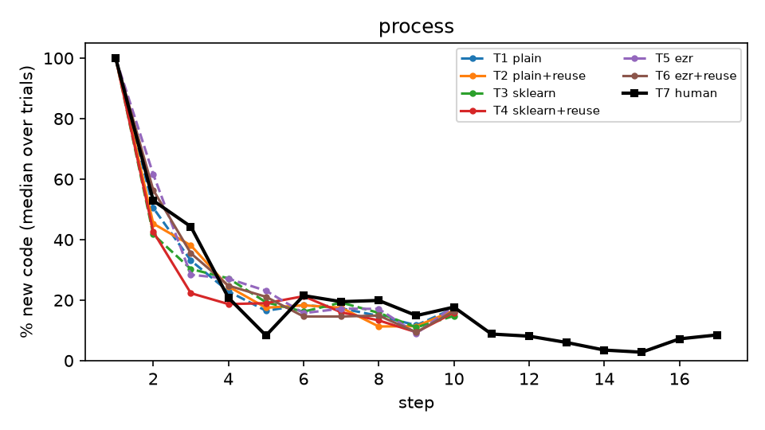

# Results

3660 calls logged, 3660 scored, up to 10 trials. Generated by `rig/report.py`; do not edit by hand.

In every table a number in brackets is a rank. Rank 0 is the best group. Treatments that share a rank are not distinguishable: `same` (Cliff's delta, Kolmogorov-Smirnov, Cohen at 0.35) could not tell them apart.

## health

1220 calls; 1220 returned a file; 1143 were scored without error (the rest earn the failure value).

### Competency and cost

Competency (lecturer's A23): if a treatment's functions mostly fail, its other numbers say little. 'Beat dumb baseline' counts programs whose Q is above what a no-effort answer earns.

| treatment | programs | demo ran | function worked | beat dumb baseline | new LOC | tokens in | tokens out | cost | clock (min) |
|---|--:|--:|--:|--:|--:|--:|--:|--:|--:|
| T1 plain | 200 | 194 | 198 (99%) | 139 (69%) | 11929 | 1.85M | 0.18M | $0.73 | 10 |
| T2 plain+reuse | 200 | 192 | 198 (99%) | 153 (76%) | 10283 | 1.76M | 0.16M | $0.68 | 9 |
| T3 sklearn | 200 | 187 | 185 (92%) | 119 (59%) | 11593 | 1.82M | 0.18M | $0.72 | 13 |
| T4 sklearn+reuse | 200 | 184 | 181 (90%) | 143 (71%) | 10735 | 1.96M | 0.18M | $0.77 | 16 |
| T5 ezr | 200 | 192 | 183 (91%) | 134 (67%) | 8831 | 3.08M | 0.17M | $1.03 | 11 |
| T6 ezr+reuse | 200 | 183 | 178 (89%) | 132 (66%) | 7959 | 3.10M | 0.16M | $1.01 | 11 |
| T7 human | 20 | 20 | 20 (100%) | 20 (100%) | 480 | 0 | 0 | $0.00 | 120 (human) |

### New lines of code per step (lower is better)

Median over the trials that returned a file; a blank cell means none did. Few lines is only reuse if Q held up: check the next table.

| treatment | s1 | s2 | s3 | s4 | s5 | s6 | s7 | s8 | s9 | s10 | s11 | s12 | s13 | s14 | s15 | s16 | s17 | s18 | s19 | s20 |
|---|--:|--:|--:|--:|--:|--:|--:|--:|--:|--:|--:|--:|--:|--:|--:|--:|--:|--:|--:|--:|
| T1 plain | 52 (4) | 60 (6) | 56 (6) | 50 (5) | 55 (3) | 57 (3) | 60 (5) | 61 (3) | 54 (4) | 91 (3) | 54 (5) | 56 (3) | 57 (4) | 55 (4) | 62 (5) | 58 (5) | 68 (4) | 60 (2) | 58 (5) | 85 (6) |
| T2 plain+reuse | 54 (5) | 55 (3) | 46 (4) | 42 (3) | 57 (4) | 56 (2) | 54 (3) | 59 (3) | 45 (2) | 76 (2) | 48 (3) | 41 (1) | 34 (1) | 46 (3) | 35 (2) | 40 (3) | 64 (4) | 59 (2) | 36 (3) | 78 (5) |
| T3 sklearn | 47 (3) | 57 (4) | 42 (3) | 51 (5) | 58 (5) | 62 (4) | 56 (4) | 65 (4) | 49 (3) | 76 (2) | 49 (3) | 64 (4) | 40 (2) | 54 (4) | 62 (5) | 63 (6) | 62 (4) | 66 (3) | 55 (5) | 76 (3) |
| T4 sklearn+reuse | 46 (3) | 58 (5) | 47 (5) | 46 (4) | 57 (4) | 54 (2) | 54 (3) | 60 (3) | 47 (2) | 72 (1) | 51 (4) | 54 (3) | 52 (3) | 50 (3) | 37 (3) | 50 (4) | 59 (3) | 60 (2) | 50 (4) | 71 (2) |
| T5 ezr | 29 (2) | 46 (2) | 31 (2) | 35 (2) | 49 (2) | 34 (1) | 44 (2) | 59 (2) | 32 (1) | 74 (2) | 32 (2) | 49 (2) | 33 (1) | 38 (2) | 47 (4) | 38 (2) | 52 (2) | 57 (1) | 32 (2) | 77 (4) |
| T6 ezr+reuse | 28 (1) | 40 (1) | 30 (1) | 34 (1) | 40 (1) | 32 (1) | 38 (1) | 57 (1) | 31 (1) | 74 (1) | 32 (1) | 41 (1) | 35 (1) | 32 (1) | 28 (1) | 34 (1) | 49 (1) | 57 (1) | 27 (1) | 62 (1) |
| T7 human | 16 (0) | 18 (0) | 27 (0) | 16 (0) | 7 (0) | 23 (0) | 26 (0) | 41 (0) | 29 (0) | 42 (0) | 23 (0) | 14 (0) | 18 (0) | 23 (0) | 10 (0) | 15 (0) | 28 (0) | 55 (0) | 14 (0) | 35 (0) |

### Per skill, on the test suite (higher is better)

Mean over test cases, pooled over trials, with rank. Every treatment faced the same test cases, built from the held-out 20% of the data. A failed program earns the skill's baseline on every case. This is the table to quote.

| skill | cases | T1 plain | T2 plain+reuse | T3 sklearn | T4 sklearn+reuse | T5 ezr | T6 ezr+reuse | T7 human |
|---|--:|--:|--:|--:|--:|--:|--:|--:|
| remember | 200 | 0.73 (0) | 0.69 (0) | 0.61 (1) | 0.61 (1) | 0.66 (1) | 0.68 (0) | 0.75 (0) |
| guess | 4000 | 0.59 (3) | 0.60 (4) | 0.58 (2) | 0.44 (5) | 0.86 (0) | 0.84 (0) | 0.67 (1) |
| certify | 4000 | 0.83 (0) | 0.84 (0) | 0.77 (1) | 0.84 (0) | 0.84 (0) | 0.84 (0) | 0.84 (0) |
| flow | 2000 | 0.27 (3) | 0.17 (4) | 0.29 (3) | 0.18 (4) | 0.48 (1) | 0.34 (2) | 0.58 (0) |
| blame | 600 | 0.09 (5) | 0.18 (1) | 0.09 (4) | 0.20 (2) | 0.05 (6) | 0.07 (3) | 0.30 (0) |
| justify | 400 | 0.61 (1) | 0.75 (3) | 0.56 (2) | 0.55 (5) | 0.85 (0) | 0.73 (4) | 0.77 (1) |
| choose | 600 | 0.33 (1) | 0.28 (1) | 0.31 (1) | 0.24 (2) | 0.02 (3) | 0.02 (3) | 0.70 (0) |
| fix | 400 | 0.98 (0) | 0.85 (1) | 0.75 (2) | 0.99 (0) | 0.40 (3) | 0.20 (4) | 1.00 (0) |
| fix: helps | 400 | 0.52 (2) | 0.51 (2) | 0.40 (3) | 0.62 (1) | 0.26 (4) | 0.18 (4) | 1.00 (0) |
| spot | 200 | 0.32 (3) | 0.45 (1) | 0.29 (3) | 0.36 (2) | 0.16 (4) | 0.11 (5) | 0.50 (0) |
| race | 600 | 0.34 (2) | 0.38 (1) | 0.43 (1) | 0.26 (3) | 0.08 (4) | 0.07 (4) | 0.68 (0) |

### Q per step (higher is better)

Each step is a different skill with its own scale, so compare down a column, not along a row.

| treatment | s1 | s2 | s3 | s4 | s5 | s6 | s7 | s8 | s9 | s10 | s11 | s12 | s13 | s14 | s15 | s16 | s17 | s18 | s19 | s20 |
|---|--:|--:|--:|--:|--:|--:|--:|--:|--:|--:|--:|--:|--:|--:|--:|--:|--:|--:|--:|--:|
| T1 plain | 0.76 (0) | 0.61 (3) | 0.85 (3) | 0.33 (3) | 0.24 (2) | 0.79 (3) | 0.42 (2) | 1.00 (1) | 0.50 (1) | 0.38 (2) | 0.76 (0) | 0.57 (4) | 0.85 (2) | 0.33 (3) | 0.00 (3) | 0.79 (2) | 0.28 (1) | 1.00 (1) | 0.00 (5) | 0.47 (2) |
| T2 plain+reuse | 0.76 (0) | 0.59 (4) | 0.85 (0) | 0.33 (4) | 0.31 (1) | 0.78 (4) | 0.47 (1) | 1.00 (2) | 0.50 (1) | 0.37 (3) | 0.76 (1) | 0.59 (3) | 0.85 (2) | 0.01 (4) | 0.22 (1) | 0.78 (3) | 0.12 (2) | 1.00 (2) | 0.50 (1) | 0.38 (2) |
| T3 sklearn | 0.76 (0) | 0.90 (0) | 0.85 (2) | 0.57 (2) | 0.22 (5) | 0.88 (0) | 0.42 (3) | 1.00 (2) | 0.50 (2) | 0.45 (1) | 0.76 (2) | 0.90 (0) | 0.85 (0) | 0.01 (4) | 0.00 (2) | 0.88 (0) | 0.28 (1) | 1.00 (2) | 0.00 (5) | 0.47 (1) |
| T4 sklearn+reuse | 0.76 (0) | 0.57 (5) | 0.85 (1) | 0.33 (4) | 0.22 (3) | 0.74 (6) | 0.42 (2) | 1.00 (1) | 0.50 (2) | 0.27 (4) | 0.76 (2) | 0.60 (3) | 0.85 (1) | 0.03 (3) | 0.22 (1) | 0.75 (5) | 0.03 (3) | 1.00 (0) | 0.50 (2) | 0.20 (3) |
| T5 ezr | 0.75 (1) | 0.88 (1) | 0.84 (4) | 0.67 (0) | 0.24 (1) | 0.87 (1) | 0.07 (4) | 0.00 (3) | 0.16 (3) | 0.00 (5) | 0.75 (4) | 0.88 (1) | 0.84 (3) | 0.58 (0) | 0.00 (4) | 0.87 (1) | 0.00 (4) | 0.95 (3) | 0.16 (3) | 0.03 (4) |
| T6 ezr+reuse | 0.75 (1) | 0.88 (1) | 0.84 (4) | 0.33 (5) | 0.39 (0) | 0.87 (2) | 0.07 (4) | 0.00 (3) | 0.12 (4) | 0.00 (6) | 0.75 (4) | 0.88 (1) | 0.84 (3) | 0.33 (2) | -0.29 (4) | 0.77 (5) | 0.00 (4) | 0.00 (4) | 0.12 (4) | 0.00 (4) |
| T7 human | 0.75 (1) | 0.67 (2) | 0.84 (4) | 0.58 (1) | 0.22 (4) | 0.77 (5) | 0.70 (0) | 1.00 (0) | 0.50 (0) | 0.68 (0) | 0.75 (3) | 0.67 (2) | 0.84 (3) | 0.58 (1) | 0.39 (0) | 0.77 (4) | 0.70 (0) | 1.00 (0) | 0.50 (0) | 0.68 (0) |

### Over all steps

New lines:

| treatment | n | median | sd | rank |
|---|--:|--:|--:|--:|
| T7 human | 20 | 23 | 12 | 0 |
| T6 ezr+reuse | 200 | 36 | 13 | 1 |
| T5 ezr | 200 | 40 | 14 | 2 |
| T4 sklearn+reuse | 200 | 51 | 11 | 3 |
| T2 plain+reuse | 200 | 52 | 14 | 4 |
| T1 plain | 200 | 57 | 12 | 5 |
| T3 sklearn | 200 | 56 | 11 | 5 |

Z (Q rescaled within each skill; higher is better):

| treatment | n | median | sd | rank |
|---|--:|--:|--:|--:|
| T7 human | 20 | 0.66 | 0.72 | 0 |
| T3 sklearn | 200 | 0.43 | 1.29 | 1 |
| T1 plain | 200 | 0.36 | 0.86 | 2 |
| T2 plain+reuse | 200 | 0.36 | 0.77 | 2 |
| T4 sklearn+reuse | 200 | 0.34 | 1.08 | 2 |
| T5 ezr | 200 | 0.21 | 0.93 | 3 |
| T6 ezr+reuse | 200 | 0.10 | 0.89 | 3 |

## hr

1220 calls; 1220 returned a file; 1071 were scored without error (the rest earn the failure value).

### Competency and cost

Competency (lecturer's A23): if a treatment's functions mostly fail, its other numbers say little. 'Beat dumb baseline' counts programs whose Q is above what a no-effort answer earns.

| treatment | programs | demo ran | function worked | beat dumb baseline | new LOC | tokens in | tokens out | cost | clock (min) |
|---|--:|--:|--:|--:|--:|--:|--:|--:|--:|
| T1 plain | 200 | 186 | 197 (98%) | 140 (70%) | 11680 | 1.84M | 0.17M | $0.71 | 10 |
| T2 plain+reuse | 200 | 191 | 190 (95%) | 138 (69%) | 10657 | 1.74M | 0.15M | $0.66 | 10 |
| T3 sklearn | 200 | 196 | 186 (93%) | 140 (70%) | 11340 | 1.93M | 0.17M | $0.74 | 13 |
| T4 sklearn+reuse | 200 | 156 | 155 (77%) | 111 (55%) | 10132 | 2.19M | 0.19M | $0.83 | 26 |
| T5 ezr | 200 | 187 | 162 (81%) | 127 (63%) | 8860 | 3.53M | 0.19M | $1.17 | 17 |
| T6 ezr+reuse | 200 | 181 | 161 (80%) | 117 (58%) | 8249 | 3.44M | 0.17M | $1.12 | 17 |
| T7 human | 20 | 20 | 20 (100%) | 19 (95%) | 485 | 0 | 0 | $0.00 | 150 (human) |

### New lines of code per step (lower is better)

Median over the trials that returned a file; a blank cell means none did. Few lines is only reuse if Q held up: check the next table.

| treatment | s1 | s2 | s3 | s4 | s5 | s6 | s7 | s8 | s9 | s10 | s11 | s12 | s13 | s14 | s15 | s16 | s17 | s18 | s19 | s20 |
|---|--:|--:|--:|--:|--:|--:|--:|--:|--:|--:|--:|--:|--:|--:|--:|--:|--:|--:|--:|--:|
| T1 plain | 41 (3) | 60 (4) | 53 (5) | 51 (6) | 56 (6) | 61 (4) | 55 (5) | 60 (4) | 55 (6) | 83 (4) | 48 (4) | 57 (4) | 56 (5) | 56 (6) | 60 (6) | 67 (5) | 60 (4) | 63 (2) | 57 (5) | 86 (4) |
| T2 plain+reuse | 45 (4) | 55 (3) | 47 (4) | 47 (4) | 51 (4) | 49 (3) | 52 (4) | 56 (2) | 52 (4) | 82 (4) | 50 (5) | 54 (3) | 38 (2) | 53 (5) | 53 (4) | 50 (2) | 54 (3) | 57 (1) | 37 (3) | 82 (4) |
| T3 sklearn | 40 (2) | 61 (5) | 44 (3) | 47 (5) | 54 (5) | 61 (4) | 56 (5) | 57 (3) | 54 (5) | 78 (3) | 51 (5) | 69 (5) | 48 (4) | 51 (4) | 58 (5) | 64 (4) | 57 (3) | 61 (1) | 57 (5) | 82 (3) |
| T4 sklearn+reuse | 40 (2) | 56 (4) | 42 (2) | 41 (3) | 50 (3) | 52 (3) | 48 (3) | 56 (2) | 47 (3) | 75 (2) | 46 (3) | 52 (2) | 44 (3) | 47 (3) | 49 (3) | 53 (3) | 55 (3) | 61 (1) | 41 (4) | 72 (1) |
| T5 ezr | 30 (1) | 46 (2) | 34 (1) | 34 (2) | 44 (2) | 31 (1) | 48 (2) | 54 (1) | 33 (2) | 71 (1) | 34 (1) | 52 (2) | 36 (1) | 36 (2) | 45 (2) | 38 (1) | 52 (2) | 58 (1) | 35 (2) | 75 (3) |
| T6 ezr+reuse | 31 (1) | 42 (1) | 33 (1) | 32 (1) | 42 (1) | 31 (2) | 38 (1) | 55 (1) | 33 (1) | 72 (1) | 40 (2) | 39 (1) | 34 (1) | 35 (1) | 40 (1) | 37 (1) | 48 (1) | 55 (0) | 28 (1) | 73 (2) |
| T7 human | 16 (0) | 18 (0) | 20 (0) | 16 (0) | 7 (0) | 23 (0) | 26 (0) | 33 (0) | 29 (0) | 42 (0) | 23 (0) | 24 (0) | 27 (0) | 24 (0) | 10 (0) | 14 (0) | 24 (0) | 57 (1) | 14 (0) | 38 (0) |

### Per skill, on the test suite (higher is better)

Mean over test cases, pooled over trials, with rank. Every treatment faced the same test cases, built from the held-out 20% of the data. A failed program earns the skill's baseline on every case. This is the table to quote.

| skill | cases | T1 plain | T2 plain+reuse | T3 sklearn | T4 sklearn+reuse | T5 ezr | T6 ezr+reuse | T7 human |
|---|--:|--:|--:|--:|--:|--:|--:|--:|
| remember | 200 | 0.21 (2) | 0.20 (2) | 0.17 (2) | 0.18 (2) | 0.32 (1) | 0.27 (1) | 0.47 (0) |
| guess | 4000 | 0.15 (4) | 0.16 (3) | 0.49 (1) | 0.17 (5) | 0.58 (0) | 0.56 (0) | 0.29 (2) |
| certify | 4000 | 0.86 (0) | 0.85 (0) | 0.85 (0) | 0.85 (0) | 0.83 (0) | 0.83 (0) | 0.82 (0) |
| flow | 2000 | 0.07 (4) | 0.11 (2) | 0.11 (1) | 0.07 (5) | 0.05 (6) | 0.06 (3) | 0.31 (0) |
| blame | 600 | 0.00 (1) | -0.00 (1) | 0.01 (0) | 0.02 (2) | -0.01 (3) | -0.02 (4) | 0.03 (0) |
| justify | 400 | 0.24 (4) | 0.16 (5) | 0.48 (2) | 0.16 (6) | 0.67 (0) | 0.57 (1) | 0.25 (3) |
| choose | 600 | 0.23 (1) | 0.19 (1) | 0.16 (2) | 0.14 (2) | 0.00 (3) | 0.01 (3) | 0.63 (0) |
| fix | 400 | 0.96 (0) | 0.93 (0) | 0.96 (0) | 0.82 (1) | 0.55 (2) | 0.23 (3) | 1.00 (0) |
| fix: helps | 400 | 0.48 (0) | 0.42 (1) | 0.46 (1) | 0.31 (2) | 0.21 (3) | 0.09 (4) | 0.65 (0) |
| spot | 200 | 0.26 (2) | 0.40 (1) | 0.22 (2) | 0.17 (3) | 0.03 (4) | 0.03 (4) | 0.50 (0) |
| race | 600 | 0.45 (0) | 0.35 (1) | 0.40 (1) | 0.22 (2) | 0.00 (3) | 0.00 (3) | 0.55 (0) |

### Q per step (higher is better)

Each step is a different skill with its own scale, so compare down a column, not along a row.

| treatment | s1 | s2 | s3 | s4 | s5 | s6 | s7 | s8 | s9 | s10 | s11 | s12 | s13 | s14 | s15 | s16 | s17 | s18 | s19 | s20 |
|---|--:|--:|--:|--:|--:|--:|--:|--:|--:|--:|--:|--:|--:|--:|--:|--:|--:|--:|--:|--:|
| T1 plain | 0.41 (1) | 0.15 (4) | 0.86 (0) | 0.01 (4) | 0.02 (4) | 0.25 (3) | 0.47 (1) | 1.00 (0) | 0.50 (2) | 0.47 (2) | -0.01 (2) | 0.15 (5) | 0.86 (0) | 0.12 (2) | 0.00 (2) | 0.45 (3) | 0.02 (1) | 1.00 (2) | 0.28 (2) | 0.37 (1) |
| T2 plain+reuse | 0.39 (1) | 0.14 (4) | 0.86 (0) | 0.16 (4) | 0.02 (5) | 0.13 (4) | 0.47 (2) | 1.00 (1) | 0.50 (1) | 0.30 (3) | -0.01 (3) | 0.17 (4) | 0.86 (0) | 0.13 (1) | -0.01 (4) | 0.33 (4) | 0.02 (2) | 1.00 (2) | 0.50 (1) | 0.30 (1) |
| T3 sklearn | 0.39 (2) | 0.69 (0) | 0.85 (1) | 0.16 (2) | 0.03 (1) | 0.72 (0) | 0.32 (2) | 1.00 (1) | 0.07 (4) | 0.73 (0) | -0.03 (4) | 0.69 (0) | 0.85 (1) | 0.05 (2) | -0.00 (2) | 0.72 (0) | 0.02 (2) | 1.00 (1) | 0.28 (2) | 0.28 (2) |
| T4 sklearn+reuse | 0.36 (3) | 0.00 (5) | 0.85 (1) | 0.16 (3) | 0.03 (2) | 0.00 (4) | 0.32 (3) | 1.00 (1) | 0.13 (3) | 0.32 (3) | -0.01 (2) | 0.00 (6) | 0.85 (1) | 0.01 (3) | 0.02 (0) | 0.00 (4) | 0.02 (2) | 1.00 (3) | 0.13 (3) | 0.20 (3) |
| T5 ezr | 0.47 (0) | 0.60 (1) | 0.83 (2) | 0.18 (2) | 0.04 (1) | 0.67 (1) | 0.00 (4) | 1.00 (2) | 0.02 (5) | 0.00 (5) | 0.21 (1) | 0.60 (2) | 0.83 (2) | -0.04 (4) | -0.01 (3) | 0.67 (1) | 0.00 (3) | 1.00 (4) | 0.04 (4) | 0.00 (5) |
| T6 ezr+reuse | 0.47 (0) | 0.60 (2) | 0.83 (2) | 0.19 (1) | 0.02 (3) | 0.67 (2) | 0.00 (4) | 0.00 (3) | 0.02 (5) | 0.00 (4) | -0.03 (5) | 0.60 (1) | 0.83 (2) | -0.04 (5) | -0.07 (5) | 0.67 (2) | 0.00 (3) | 0.00 (5) | 0.02 (5) | 0.00 (4) |
| T7 human | 0.47 (0) | 0.29 (3) | 0.82 (3) | 0.31 (0) | 0.06 (0) | 0.25 (3) | 0.63 (0) | 1.00 (0) | 0.50 (0) | 0.65 (1) | 0.47 (0) | 0.29 (3) | 0.82 (3) | 0.31 (0) | 0.01 (1) | 0.25 (4) | 0.63 (0) | 1.00 (0) | 0.50 (0) | 0.45 (0) |

### Over all steps

New lines:

| treatment | n | median | sd | rank |
|---|--:|--:|--:|--:|
| T7 human | 20 | 24 | 11 | 0 |
| T6 ezr+reuse | 200 | 38 | 13 | 1 |
| T5 ezr | 200 | 41 | 14 | 2 |
| T4 sklearn+reuse | 200 | 47 | 12 | 3 |
| T2 plain+reuse | 200 | 52 | 12 | 4 |
| T1 plain | 200 | 57 | 11 | 5 |
| T3 sklearn | 200 | 55 | 11 | 5 |

Z (Q rescaled within each skill; higher is better):

| treatment | n | median | sd | rank |
|---|--:|--:|--:|--:|
| T7 human | 20 | 0.93 | 1.25 | 0 |
| T3 sklearn | 200 | 0.62 | 0.92 | 1 |
| T1 plain | 200 | 0.35 | 0.93 | 2 |
| T2 plain+reuse | 200 | 0.22 | 0.95 | 2 |
| T4 sklearn+reuse | 200 | 0.13 | 0.90 | 3 |
| T5 ezr | 200 | -0.68 | 1.05 | 4 |
| T6 ezr+reuse | 200 | -0.68 | 1.00 | 4 |

## process

1220 calls; 1220 returned a file; 1155 were scored without error (the rest earn the failure value).

### Competency and cost

Competency (lecturer's A23): if a treatment's functions mostly fail, its other numbers say little. 'Beat dumb baseline' counts programs whose Q is above what a no-effort answer earns.

| treatment | programs | demo ran | function worked | beat dumb baseline | new LOC | tokens in | tokens out | cost | clock (min) |
|---|--:|--:|--:|--:|--:|--:|--:|--:|--:|
| T1 plain | 200 | 195 | 197 (98%) | 129 (64%) | 11142 | 1.78M | 0.16M | $0.68 | 9 |
| T2 plain+reuse | 200 | 197 | 199 (99%) | 126 (63%) | 9668 | 1.68M | 0.14M | $0.63 | 8 |
| T3 sklearn | 200 | 190 | 198 (99%) | 138 (69%) | 11292 | 1.92M | 0.17M | $0.74 | 22 |
| T4 sklearn+reuse | 200 | 191 | 199 (99%) | 135 (67%) | 10050 | 1.85M | 0.16M | $0.71 | 16 |
| T5 ezr | 200 | 189 | 175 (87%) | 135 (67%) | 9224 | 3.35M | 0.18M | $1.11 | 13 |
| T6 ezr+reuse | 200 | 179 | 167 (83%) | 138 (69%) | 8304 | 3.24M | 0.16M | $1.05 | 15 |
| T7 human | 20 | 20 | 20 (100%) | 19 (95%) | 475 | 0 | 0 | $0.00 | 485 (human) |

### New lines of code per step (lower is better)

Median over the trials that returned a file; a blank cell means none did. Few lines is only reuse if Q held up: check the next table.

| treatment | s1 | s2 | s3 | s4 | s5 | s6 | s7 | s8 | s9 | s10 | s11 | s12 | s13 | s14 | s15 | s16 | s17 | s18 | s19 | s20 |
|---|--:|--:|--:|--:|--:|--:|--:|--:|--:|--:|--:|--:|--:|--:|--:|--:|--:|--:|--:|--:|
| T1 plain | 49 (3) | 50 (4) | 47 (4) | 46 (4) | 38 (3) | 52 (4) | 59 (4) | 53 (1) | 55 (6) | 85 (4) | 50 (3) | 57 (5) | 49 (5) | 50 (4) | 46 (4) | 59 (4) | 66 (4) | 60 (2) | 59 (6) | 89 (4) |
| T2 plain+reuse | 46 (2) | 41 (1) | 45 (3) | 43 (3) | 38 (2) | 50 (3) | 52 (3) | 49 (1) | 46 (4) | 81 (2) | 47 (3) | 48 (2) | 39 (3) | 44 (3) | 39 (3) | 49 (2) | 60 (3) | 54 (1) | 34 (2) | 85 (3) |
| T3 sklearn | 48 (3) | 48 (3) | 45 (3) | 50 (6) | 45 (4) | 56 (5) | 69 (4) | 58 (3) | 49 (5) | 83 (3) | 61 (4) | 51 (3) | 55 (6) | 50 (4) | 50 (5) | 58 (4) | 66 (4) | 59 (2) | 48 (5) | 88 (4) |
| T4 sklearn+reuse | 48 (3) | 44 (1) | 39 (2) | 47 (5) | 36 (1) | 53 (4) | 60 (4) | 56 (2) | 40 (3) | 77 (2) | 47 (3) | 45 (1) | 42 (4) | 51 (4) | 38 (2) | 51 (3) | 64 (4) | 63 (2) | 42 (4) | 87 (3) |
| T5 ezr | 31 (1) | 46 (3) | 33 (1) | 38 (2) | 43 (4) | 32 (1) | 47 (2) | 56 (2) | 37 (2) | 77 (2) | 34 (1) | 55 (4) | 34 (2) | 39 (2) | 47 (4) | 42 (2) | 57 (2) | 59 (2) | 39 (3) | 81 (2) |
| T6 ezr+reuse | 33 (1) | 44 (2) | 36 (1) | 34 (1) | 39 (3) | 38 (2) | 41 (1) | 51 (1) | 34 (1) | 71 (1) | 35 (2) | 46 (1) | 31 (1) | 37 (1) | 28 (1) | 35 (1) | 47 (1) | 56 (1) | 27 (1) | 74 (1) |
| T7 human | 16 (0) | 18 (0) | 27 (0) | 16 (0) | 7 (0) | 23 (0) | 26 (0) | 33 (0) | 29 (0) | 42 (0) | 23 (0) | 23 (0) | 18 (0) | 11 (0) | 9 (0) | 25 (0) | 32 (0) | 48 (0) | 12 (0) | 37 (0) |

### Per skill, on the test suite (higher is better)

Mean over test cases, pooled over trials, with rank. Every treatment faced the same test cases, built from the held-out 20% of the data. A failed program earns the skill's baseline on every case. This is the table to quote.

| skill | cases | T1 plain | T2 plain+reuse | T3 sklearn | T4 sklearn+reuse | T5 ezr | T6 ezr+reuse | T7 human |
|---|--:|--:|--:|--:|--:|--:|--:|--:|
| remember | 200 | 0.65 (1) | 0.74 (0) | 0.67 (1) | 0.73 (0) | 0.74 (0) | 0.70 (1) | 0.74 (0) |
| guess | 4000 | 0.41 (2) | 0.22 (4) | 0.62 (0) | 0.61 (0) | 0.40 (3) | 0.40 (3) | 0.57 (1) |
| certify | 4000 | 0.81 (1) | 0.81 (1) | 0.84 (0) | 0.84 (0) | 0.84 (0) | 0.84 (0) | 0.84 (0) |
| flow | 2000 | -0.16 (5) | -0.08 (3) | -0.23 (6) | -0.11 (4) | -0.06 (2) | 0.06 (1) | 0.56 (0) |
| blame | 600 | 0.01 (2) | 0.00 (4) | 0.00 (2) | -0.01 (3) | 0.06 (0) | 0.05 (1) | 0.04 (0) |
| justify | 400 | -0.07 (5) | 0.04 (4) | 0.23 (2) | 0.30 (1) | 0.13 (3) | 0.17 (3) | 0.40 (0) |
| choose | 600 | 0.41 (1) | 0.42 (1) | 0.41 (1) | 0.36 (1) | 0.09 (2) | 0.05 (2) | 0.68 (0) |
| fix | 400 | 0.85 (1) | 0.80 (2) | 0.95 (0) | 0.90 (1) | 0.53 (4) | 0.65 (3) | 1.00 (0) |
| fix: helps | 400 | 0.34 (2) | 0.27 (2) | 0.47 (1) | 0.45 (1) | 0.24 (3) | 0.28 (2) | 0.85 (0) |
| spot | 200 | 0.45 (3) | 0.48 (1) | 0.44 (3) | 0.46 (2) | 0.16 (4) | 0.06 (5) | 0.50 (0) |
| race | 600 | 0.34 (1) | 0.36 (1) | 0.36 (1) | 0.36 (1) | 0.05 (2) | 0.05 (2) | 0.57 (0) |

### Q per step (higher is better)

Each step is a different skill with its own scale, so compare down a column, not along a row.

| treatment | s1 | s2 | s3 | s4 | s5 | s6 | s7 | s8 | s9 | s10 | s11 | s12 | s13 | s14 | s15 | s16 | s17 | s18 | s19 | s20 |
|---|--:|--:|--:|--:|--:|--:|--:|--:|--:|--:|--:|--:|--:|--:|--:|--:|--:|--:|--:|--:|
| T1 plain | 0.74 (2) | 0.38 (3) | 0.80 (2) | -0.02 (4) | 0.00 (3) | 0.21 (4) | 0.43 (3) | 1.00 (1) | 0.50 (2) | 0.48 (1) | 0.74 (0) | 0.38 (3) | 0.80 (2) | -0.25 (2) | 0.03 (1) | 0.21 (3) | 0.43 (1) | 1.00 (0) | 0.50 (1) | 0.38 (1) |
| T2 plain+reuse | 0.74 (0) | 0.14 (4) | 0.81 (2) | -0.02 (3) | -0.02 (4) | 0.21 (3) | 0.43 (2) | 1.00 (1) | 0.50 (1) | 0.48 (1) | 0.74 (0) | 0.17 (5) | 0.81 (2) | -0.10 (1) | 0.03 (2) | 0.21 (3) | 0.43 (1) | 1.00 (0) | 0.50 (1) | 0.40 (1) |
| T3 sklearn | 0.74 (0) | 0.56 (1) | 0.84 (1) | -0.04 (4) | -0.03 (5) | 0.22 (2) | 0.43 (1) | 1.00 (0) | 0.49 (3) | 0.48 (1) | 0.74 (2) | 0.74 (0) | 0.84 (1) | -0.44 (3) | 0.03 (1) | 0.22 (2) | 0.30 (2) | 1.00 (0) | 0.49 (3) | 0.38 (1) |
| T4 sklearn+reuse | 0.74 (1) | 0.56 (1) | 0.84 (1) | -0.02 (2) | -0.03 (6) | 0.22 (1) | 0.40 (4) | 1.00 (0) | 0.45 (4) | 0.40 (1) | 0.74 (1) | 0.74 (1) | 0.84 (1) | -0.32 (2) | 0.03 (2) | 0.22 (1) | 0.32 (2) | 1.00 (1) | 0.49 (2) | 0.37 (1) |
| T5 ezr | 0.74 (3) | 0.43 (2) | 0.84 (0) | -0.02 (2) | 0.06 (0) | 0.13 (6) | 0.00 (5) | 0.00 (3) | 0.07 (5) | 0.00 (2) | 0.74 (3) | 0.35 (4) | 0.84 (0) | -0.16 (1) | 0.04 (0) | 0.13 (5) | 0.00 (3) | 1.00 (2) | 0.12 (4) | 0.00 (2) |
| T6 ezr+reuse | 0.74 (3) | 0.43 (2) | 0.84 (0) | 0.43 (1) | 0.06 (1) | 0.19 (5) | 0.00 (6) | 1.00 (2) | 0.07 (6) | 0.00 (3) | 0.74 (4) | 0.37 (4) | 0.84 (0) | -0.08 (1) | 0.04 (0) | 0.19 (4) | 0.00 (4) | 1.00 (2) | 0.07 (5) | 0.00 (2) |
| T7 human | 0.74 (3) | 0.57 (0) | 0.84 (0) | 0.56 (0) | 0.05 (2) | 0.40 (0) | 0.68 (0) | 1.00 (0) | 0.50 (0) | 0.68 (0) | 0.74 (3) | 0.57 (2) | 0.84 (0) | 0.56 (0) | 0.04 (0) | 0.40 (0) | 0.68 (0) | 1.00 (0) | 0.50 (0) | 0.45 (0) |

### Over all steps

New lines:

| treatment | n | median | sd | rank |
|---|--:|--:|--:|--:|
| T7 human | 20 | 23 | 11 | 0 |
| T6 ezr+reuse | 200 | 39 | 13 | 1 |
| T5 ezr | 200 | 43 | 14 | 2 |
| T2 plain+reuse | 200 | 46 | 13 | 3 |
| T4 sklearn+reuse | 200 | 47 | 14 | 3 |
| T1 plain | 200 | 52 | 14 | 4 |
| T3 sklearn | 200 | 53 | 13 | 4 |

Z (Q rescaled within each skill; higher is better):

| treatment | n | median | sd | rank |
|---|--:|--:|--:|--:|
| T7 human | 20 | 0.82 | 0.60 | 0 |
| T3 sklearn | 200 | 0.38 | 0.88 | 1 |
| T4 sklearn+reuse | 200 | 0.38 | 0.84 | 1 |
| T1 plain | 200 | 0.25 | 1.04 | 2 |
| T2 plain+reuse | 200 | 0.25 | 1.12 | 2 |
| T5 ezr | 200 | -0.01 | 0.93 | 3 |
| T6 ezr+reuse | 200 | -0.01 | 1.03 | 3 |

## All domains together

### Competency and cost

| treatment | programs | demo ran | function worked | beat dumb baseline | new LOC | tokens in | tokens out | cost | clock (min) |
|---|--:|--:|--:|--:|--:|--:|--:|--:|--:|
| T1 plain | 600 | 575 | 592 (98%) | 408 (68%) | 34751 | 5.47M | 0.50M | $2.12 | 29 |
| T2 plain+reuse | 600 | 580 | 587 (97%) | 417 (69%) | 30608 | 5.18M | 0.46M | $1.98 | 27 |
| T3 sklearn | 600 | 573 | 569 (94%) | 397 (66%) | 34225 | 5.67M | 0.52M | $2.20 | 47 |
| T4 sklearn+reuse | 600 | 531 | 535 (89%) | 389 (64%) | 30917 | 6.00M | 0.54M | $2.30 | 58 |
| T5 ezr | 600 | 568 | 520 (86%) | 396 (66%) | 26915 | 9.96M | 0.55M | $3.31 | 42 |
| T6 ezr+reuse | 600 | 543 | 506 (84%) | 387 (64%) | 24512 | 9.78M | 0.49M | $3.18 | 44 |
| T7 human | 60 | 60 | 60 (100%) | 58 (96%) | 1440 | 0 | 0 | $0.00 | 755 (human) |

### Transfer across domains (T7)

Treatment 7 across domains. Shared code (`t7/shared/`, 8 files) is available to every domain; a falling per-domain count, in the order the domains were built, is the transfer the hypothesis predicts.

| domain | steps | lines written for it | shared lines | shared share |
|---|--:|--:|--:|--:|
| health | 20 | 480 | 278 | 36% |
| hr | 20 | 485 | 278 | 36% |
| process | 20 | 475 | 278 | 36% |

Z is computed within each (domain, skill), then pooled.

| treatment | n | median | sd | rank |
|---|--:|--:|--:|--:|
| T7 human | 60 | 0.79 | 0.91 | 0 |
| T3 sklearn | 600 | 0.46 | 1.06 | 1 |
| T1 plain | 600 | 0.29 | 0.96 | 2 |
| T2 plain+reuse | 600 | 0.26 | 0.97 | 2 |
| T4 sklearn+reuse | 600 | 0.34 | 0.96 | 2 |
| T5 ezr | 600 | -0.01 | 0.97 | 3 |
| T6 ezr+reuse | 600 | -0.27 | 0.98 | 3 |

New lines, pooled:

| treatment | n | median | sd | rank |
|---|--:|--:|--:|--:|
| T7 human | 60 | 23 | 11 | 0 |
| T6 ezr+reuse | 600 | 37 | 13 | 1 |
| T5 ezr | 600 | 41 | 14 | 2 |
| T2 plain+reuse | 600 | 49 | 13 | 3 |
| T4 sklearn+reuse | 600 | 49 | 12 | 3 |
| T1 plain | 600 | 56 | 12 | 4 |
| T3 sklearn | 600 | 55 | 12 | 4 |
