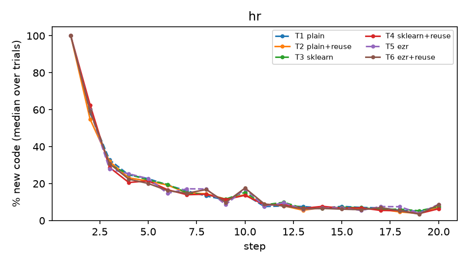

# Results

1100 calls logged, 1100 scored, up to 3 trials. Generated by `rig/report.py`; do not edit by hand.

In every table a number in brackets is a rank. Rank 0 is the best group. Treatments that share a rank are not distinguishable: `same` (Cliff's delta, Kolmogorov-Smirnov, Cohen at 0.35) could not tell them apart.

**N = 3.** With so few trials per cell `same` has little to work with: at N = 3 the Kolmogorov-Smirnov test can never report a difference. Read per-step ranks as provisional.

## health

360 calls; 360 returned a file; 338 were scored without error (the rest earn the failure value).

### Competency and cost

Competency (lecturer's A23): if a treatment's functions mostly fail, its other numbers say little. 'Beat dumb baseline' counts programs whose Q is above what a no-effort answer earns.

| treatment | programs | demo ran | function worked | beat dumb baseline | new LOC | tokens in | tokens out | cost | clock (min) |
|---|--:|--:|--:|--:|--:|--:|--:|--:|--:|
| T1 plain | 60 | 57 | 58 (96%) | 39 (65%) | 3730 | 0.60M | 0.06M | $0.23 | 3 |
| T2 plain+reuse | 60 | 58 | 60 (100%) | 47 (78%) | 3039 | 0.52M | 0.05M | $0.20 | 3 |
| T3 sklearn | 60 | 58 | 59 (98%) | 39 (65%) | 3393 | 0.51M | 0.05M | $0.20 | 4 |
| T4 sklearn+reuse | 60 | 53 | 54 (90%) | 44 (73%) | 3202 | 0.63M | 0.06M | $0.25 | 6 |
| T5 ezr | 60 | 56 | 54 (90%) | 41 (68%) | 2682 | 0.92M | 0.05M | $0.31 | 4 |
| T6 ezr+reuse | 60 | 55 | 53 (88%) | 40 (66%) | 2409 | 0.92M | 0.05M | $0.30 | 4 |

### New lines of code per step (lower is better)

Median over the trials that returned a file; a blank cell means none did. Few lines is only reuse if Q held up: check the next table.

| treatment | s1 | s2 | s3 | s4 | s5 | s6 | s7 | s8 | s9 | s10 | s11 | s12 | s13 | s14 | s15 | s16 | s17 | s18 | s19 | s20 |
|---|--:|--:|--:|--:|--:|--:|--:|--:|--:|--:|--:|--:|--:|--:|--:|--:|--:|--:|--:|--:|
| T1 plain | 48 (4) | 61 (5) | 56 (5) | 50 (4) | 56 (2) | 63 (5) | 60 (4) | 70 (4) | 54 (4) | 91 (4) | 57 (4) | 59 (4) | 62 (4) | 52 (3) | 62 (4) | 58 (3) | 65 (4) | 69 (4) | 54 (3) | 94 (4) |
| T2 plain+reuse | 53 (5) | 57 (3) | 42 (3) | 41 (2) | 57 (3) | 53 (3) | 52 (2) | 59 (2) | 49 (3) | 62 (0) | 47 (2) | 43 (1) | 31 (0) | 51 (3) | 32 (1) | 41 (2) | 51 (1) | 60 (1) | 54 (2) | 66 (0) |
| T3 sklearn | 47 (3) | 56 (2) | 42 (2) | 55 (4) | 58 (3) | 53 (4) | 52 (2) | 66 (4) | 46 (3) | 67 (1) | 49 (2) | 56 (4) | 40 (2) | 56 (4) | 62 (5) | 58 (3) | 61 (3) | 67 (3) | 55 (4) | 76 (2) |
| T4 sklearn+reuse | 46 (2) | 58 (4) | 44 (4) | 46 (3) | 54 (2) | 45 (2) | 56 (3) | 61 (3) | 40 (2) | 70 (2) | 52 (3) | 51 (3) | 54 (3) | 45 (2) | 36 (2) | 60 (3) | 61 (3) | 66 (2) | 48 (2) | 62 (0) |
| T5 ezr | 29 (1) | 47 (1) | 31 (1) | 35 (1) | 51 (1) | 35 (1) | 43 (1) | 57 (1) | 31 (0) | 74 (3) | 35 (1) | 48 (2) | 32 (0) | 39 (1) | 53 (3) | 38 (1) | 58 (2) | 54 (0) | 30 (1) | 76 (3) |
| T6 ezr+reuse | 28 (0) | 41 (0) | 29 (0) | 33 (0) | 39 (0) | 31 (0) | 36 (0) | 54 (0) | 33 (1) | 78 (3) | 31 (0) | 38 (0) | 37 (1) | 36 (0) | 25 (0) | 34 (0) | 49 (0) | 55 (0) | 30 (0) | 69 (1) |

### Per skill, on the test suite (higher is better)

Mean over test cases, pooled over trials, with rank. Every treatment faced the same test cases, built from the held-out 20% of the data. A failed program earns the skill's baseline on every case. This is the table to quote.

| skill | cases | T1 plain | T2 plain+reuse | T3 sklearn | T4 sklearn+reuse | T5 ezr | T6 ezr+reuse |
|---|--:|--:|--:|--:|--:|--:|--:|
| remember | 60 | 0.76 (0) | 0.72 (1) | 0.76 (0) | 0.66 (1) | 0.66 (1) | 0.69 (1) |
| guess | 1200 | 0.61 (4) | 0.69 (3) | 0.90 (0) | 0.75 (2) | 0.81 (1) | 0.81 (1) |
| certify | 1200 | 0.84 (0) | 0.85 (0) | 0.80 (0) | 0.80 (0) | 0.84 (0) | 0.84 (0) |
| flow | 600 | 0.17 (2) | 0.12 (3) | 0.28 (1) | 0.17 (2) | 0.39 (0) | 0.28 (1) |
| blame | 180 | 0.13 (5) | 0.12 (0) | 0.09 (3) | 0.18 (1) | 0.05 (4) | 0.08 (2) |
| justify | 120 | 0.25 (4) | 0.74 (2) | 0.86 (0) | 0.54 (3) | 0.81 (1) | 0.80 (1) |
| choose | 180 | 0.32 (0) | 0.25 (0) | 0.38 (0) | 0.31 (0) | 0.02 (1) | 0.02 (1) |
| fix | 120 | 1.00 (0) | 1.00 (0) | 0.50 (1) | 0.98 (0) | 0.50 (1) | 0.33 (1) |
| fix: helps | 120 | 0.62 (0) | 0.70 (0) | 0.30 (1) | 0.74 (0) | 0.25 (1) | 0.33 (1) |
| spot | 60 | 0.25 (1) | 0.42 (0) | 0.34 (1) | 0.27 (1) | 0.14 (2) | 0.13 (2) |
| race | 180 | 0.33 (1) | 0.42 (0) | 0.41 (0) | 0.47 (0) | 0.16 (2) | 0.08 (2) |

### Q per step (higher is better)

Each step is a different skill with its own scale, so compare down a column, not along a row.

| treatment | s1 | s2 | s3 | s4 | s5 | s6 | s7 | s8 | s9 | s10 | s11 | s12 | s13 | s14 | s15 | s16 | s17 | s18 | s19 | s20 |
|---|--:|--:|--:|--:|--:|--:|--:|--:|--:|--:|--:|--:|--:|--:|--:|--:|--:|--:|--:|--:|
| T1 plain | 0.76 (0) | 0.59 (4) | 0.85 (0) | 0.03 (3) | 0.14 (4) | 0.74 (4) | 0.42 (0) | 1.00 (0) | 0.50 (1) | 0.50 (1) | 0.76 (0) | 0.58 (4) | 0.85 (2) | -0.01 (3) | 0.00 (0) | 0.74 (5) | 0.13 (1) | 1.00 (0) | 0.00 (3) | 0.48 (2) |
| T2 plain+reuse | 0.76 (0) | 0.76 (3) | 0.84 (2) | 0.33 (2) | 0.31 (1) | 0.74 (3) | 0.42 (1) | 1.00 (0) | 0.50 (0) | 0.50 (0) | 0.55 (2) | 0.70 (3) | 0.84 (3) | 0.01 (1) | -0.09 (2) | 0.74 (4) | 0.08 (2) | 1.00 (0) | 0.50 (0) | 0.50 (1) |
| T3 sklearn | 0.76 (0) | 0.90 (0) | 0.85 (1) | 0.33 (1) | 0.22 (4) | 0.88 (0) | 0.42 (0) | 0.00 (2) | 0.50 (1) | 0.45 (2) | 0.76 (0) | 0.90 (0) | 0.85 (0) | -0.00 (2) | 0.00 (1) | 0.88 (0) | 0.32 (0) | 1.00 (1) | 0.50 (0) | 0.47 (2) |
| T4 sklearn+reuse | 0.76 (0) | 0.90 (1) | 0.85 (1) | 0.33 (2) | 0.22 (3) | 0.00 (4) | 0.42 (0) | 0.95 (1) | 0.50 (1) | 0.45 (2) | 0.76 (1) | 0.90 (0) | 0.85 (1) | -0.01 (2) | 0.22 (0) | 0.87 (1) | 0.27 (1) | 1.00 (0) | 0.10 (2) | 0.80 (0) |
| T5 ezr | 0.75 (1) | 0.88 (2) | 0.84 (3) | 0.33 (0) | 0.24 (2) | 0.79 (2) | 0.07 (2) | 0.00 (2) | 0.12 (2) | 0.00 (3) | 0.75 (2) | 0.86 (2) | 0.84 (4) | 0.33 (0) | -0.29 (3) | 0.79 (2) | 0.00 (3) | 1.00 (1) | 0.16 (1) | 0.00 (3) |
| T6 ezr+reuse | 0.75 (1) | 0.88 (2) | 0.84 (3) | 0.33 (1) | 0.39 (0) | 0.87 (1) | 0.07 (2) | 0.00 (2) | 0.11 (3) | 0.00 (4) | 0.75 (2) | 0.88 (1) | 0.84 (4) | -0.01 (2) | -0.29 (3) | 0.77 (3) | 0.00 (3) | 0.00 (2) | 0.16 (1) | 0.00 (3) |

### Over all steps

New lines:

| treatment | n | median | sd | rank |
|---|--:|--:|--:|--:|
| T6 ezr+reuse | 60 | 36 | 14 | 0 |
| T5 ezr | 60 | 42 | 14 | 1 |
| T2 plain+reuse | 60 | 52 | 12 | 2 |
| T4 sklearn+reuse | 60 | 52 | 11 | 2 |
| T3 sklearn | 60 | 56 | 10 | 3 |
| T1 plain | 60 | 59 | 12 | 4 |

Z (Q rescaled within each skill; higher is better):

| treatment | n | median | sd | rank |
|---|--:|--:|--:|--:|
| T3 sklearn | 60 | 0.50 | 0.92 | 0 |
| T4 sklearn+reuse | 60 | 0.41 | 1.26 | 0 |
| T1 plain | 60 | 0.33 | 1.03 | 1 |
| T2 plain+reuse | 60 | 0.26 | 0.78 | 1 |
| T5 ezr | 60 | 0.20 | 0.96 | 1 |
| T6 ezr+reuse | 60 | 0.14 | 0.90 | 1 |

## hr

360 calls; 360 returned a file; 328 were scored without error (the rest earn the failure value).

### Competency and cost

Competency (lecturer's A23): if a treatment's functions mostly fail, its other numbers say little. 'Beat dumb baseline' counts programs whose Q is above what a no-effort answer earns.

| treatment | programs | demo ran | function worked | beat dumb baseline | new LOC | tokens in | tokens out | cost | clock (min) |
|---|--:|--:|--:|--:|--:|--:|--:|--:|--:|
| T1 plain | 60 | 58 | 60 (100%) | 45 (75%) | 3549 | 0.55M | 0.05M | $0.21 | 4 |
| T2 plain+reuse | 60 | 60 | 60 (100%) | 45 (75%) | 3122 | 0.50M | 0.04M | $0.19 | 4 |
| T3 sklearn | 60 | 60 | 60 (100%) | 47 (78%) | 3483 | 0.54M | 0.05M | $0.21 | 4 |
| T4 sklearn+reuse | 60 | 52 | 44 (73%) | 29 (48%) | 3013 | 0.65M | 0.06M | $0.25 | 6 |
| T5 ezr | 60 | 58 | 52 (86%) | 38 (63%) | 2703 | 1.05M | 0.06M | $0.35 | 4 |
| T6 ezr+reuse | 60 | 56 | 52 (86%) | 38 (63%) | 2419 | 0.96M | 0.05M | $0.31 | 5 |

### New lines of code per step (lower is better)

Median over the trials that returned a file; a blank cell means none did. Few lines is only reuse if Q held up: check the next table.

| treatment | s1 | s2 | s3 | s4 | s5 | s6 | s7 | s8 | s9 | s10 | s11 | s12 | s13 | s14 | s15 | s16 | s17 | s18 | s19 | s20 |
|---|--:|--:|--:|--:|--:|--:|--:|--:|--:|--:|--:|--:|--:|--:|--:|--:|--:|--:|--:|--:|
| T1 plain | 40 (4) | 60 (3) | 53 (4) | 49 (5) | 55 (5) | 60 (4) | 61 (5) | 58 (3) | 54 (4) | 86 (2) | 46 (2) | 52 (3) | 56 (5) | 53 (3) | 68 (4) | 67 (3) | 65 (5) | 58 (3) | 60 (5) | 78 (3) |
| T2 plain+reuse | 45 (5) | 55 (2) | 45 (3) | 43 (3) | 51 (3) | 53 (3) | 51 (3) | 58 (2) | 53 (3) | 74 (1) | 51 (3) | 50 (1) | 37 (2) | 50 (2) | 52 (2) | 52 (1) | 52 (3) | 42 (1) | 36 (3) | 78 (2) |
| T3 sklearn | 40 (2) | 61 (4) | 44 (2) | 48 (4) | 55 (4) | 61 (5) | 56 (4) | 60 (5) | 52 (2) | 81 (2) | 51 (3) | 66 (4) | 48 (4) | 50 (2) | 58 (3) | 62 (3) | 60 (4) | 62 (4) | 57 (4) | 86 (4) |
| T4 sklearn+reuse | 40 (3) | 65 (5) | 42 (1) | 40 (2) | 51 (2) | 42 (2) | 47 (2) | 54 (1) | 51 (1) | 65 (0) | 46 (2) | 52 (3) | 42 (3) | 56 (3) | 52 (2) | 53 (2) | 47 (0) | 47 (2) | 36 (2) | 67 (0) |
| T5 ezr | 30 (0) | 46 (1) | 31 (0) | 34 (1) | 41 (1) | 32 (0) | 41 (1) | 59 (4) | 32 (0) | 76 (1) | 35 (0) | 51 (2) | 34 (1) | 36 (1) | 44 (1) | 36 (0) | 52 (2) | 60 (3) | 35 (1) | 84 (3) |
| T6 ezr+reuse | 31 (1) | 44 (0) | 33 (0) | 32 (0) | 36 (0) | 35 (1) | 38 (0) | 51 (0) | 33 (0) | 69 (0) | 40 (1) | 38 (0) | 32 (0) | 35 (0) | 37 (0) | 37 (0) | 48 (1) | 38 (0) | 25 (0) | 70 (1) |

### Per skill, on the test suite (higher is better)

Mean over test cases, pooled over trials, with rank. Every treatment faced the same test cases, built from the held-out 20% of the data. A failed program earns the skill's baseline on every case. This is the table to quote.

| skill | cases | T1 plain | T2 plain+reuse | T3 sklearn | T4 sklearn+reuse | T5 ezr | T6 ezr+reuse |
|---|--:|--:|--:|--:|--:|--:|--:|
| remember | 60 | 0.21 (1) | 0.20 (1) | 0.17 (1) | 0.17 (1) | 0.33 (0) | 0.23 (1) |
| guess | 1200 | 0.19 (3) | 0.18 (3) | 0.48 (2) | 0.00 (4) | 0.53 (1) | 0.60 (0) |
| certify | 1200 | 0.85 (0) | 0.86 (0) | 0.85 (0) | 0.85 (0) | 0.83 (0) | 0.83 (0) |
| flow | 600 | 0.04 (3) | 0.16 (0) | 0.09 (1) | 0.06 (2) | -0.05 (4) | 0.06 (2) |
| blame | 180 | -0.00 (2) | 0.01 (1) | 0.01 (1) | 0.01 (3) | -0.00 (0) | -0.02 (4) |
| justify | 120 | 0.43 (1) | 0.22 (2) | 0.64 (0) | 0.00 (3) | 0.67 (0) | 0.68 (0) |
| choose | 180 | 0.25 (0) | 0.19 (0) | 0.17 (0) | 0.16 (0) | 0.01 (1) | 0.01 (1) |
| fix | 120 | 0.99 (0) | 1.00 (0) | 0.88 (1) | 1.00 (0) | 0.33 (2) | 0.43 (2) |
| fix: helps | 120 | 0.56 (0) | 0.48 (0) | 0.42 (0) | 0.44 (0) | 0.13 (1) | 0.18 (1) |
| spot | 60 | 0.33 (1) | 0.50 (0) | 0.34 (1) | 0.29 (1) | 0.03 (2) | 0.04 (2) |
| race | 180 | 0.49 (0) | 0.49 (0) | 0.61 (0) | 0.30 (1) | 0.00 (2) | 0.01 (2) |

### Q per step (higher is better)

Each step is a different skill with its own scale, so compare down a column, not along a row.

| treatment | s1 | s2 | s3 | s4 | s5 | s6 | s7 | s8 | s9 | s10 | s11 | s12 | s13 | s14 | s15 | s16 | s17 | s18 | s19 | s20 |
|---|--:|--:|--:|--:|--:|--:|--:|--:|--:|--:|--:|--:|--:|--:|--:|--:|--:|--:|--:|--:|
| T1 plain | 0.46 (2) | 0.18 (2) | 0.86 (1) | -0.04 (4) | 0.02 (4) | 0.43 (3) | 0.47 (0) | 1.00 (0) | 0.50 (1) | 0.43 (1) | -0.01 (1) | 0.17 (4) | 0.86 (1) | 0.09 (1) | 0.01 (0) | 0.47 (3) | 0.02 (0) | 1.00 (1) | 0.28 (1) | 0.37 (1) |
| T2 plain+reuse | 0.39 (3) | 0.14 (3) | 0.86 (0) | 0.16 (2) | 0.02 (3) | 0.13 (4) | 0.32 (1) | 1.00 (0) | 0.50 (0) | 0.30 (2) | -0.01 (2) | 0.17 (3) | 0.86 (0) | 0.15 (0) | -0.01 (4) | 0.33 (4) | 0.02 (0) | 1.00 (0) | 0.50 (0) | 0.65 (0) |
| T3 sklearn | 0.36 (4) | 0.69 (0) | 0.85 (2) | 0.18 (1) | 0.03 (1) | 0.72 (0) | 0.32 (2) | 1.00 (1) | 0.50 (1) | 0.73 (0) | -0.03 (3) | 0.69 (0) | 0.85 (2) | 0.04 (1) | -0.00 (2) | 0.72 (0) | 0.02 (0) | 1.00 (1) | 0.28 (1) | 0.63 (1) |
| T4 sklearn+reuse | 0.36 (5) | 0.00 (4) | 0.85 (2) | 0.16 (2) | 0.03 (2) | 0.00 (5) | 0.32 (3) | 1.00 (0) | 0.30 (2) | 0.32 (2) | -0.01 (2) | 0.00 (5) | 0.85 (2) | -0.00 (2) | 0.00 (1) | 0.00 (5) | 0.02 (0) | 1.00 (0) | 0.30 (1) | 0.10 (2) |
| T5 ezr | 0.47 (0) | 0.60 (1) | 0.83 (3) | 0.01 (3) | 0.04 (0) | 0.67 (2) | 0.00 (4) | 0.00 (3) | 0.02 (4) | 0.00 (4) | 0.21 (0) | 0.60 (2) | 0.83 (3) | -0.10 (4) | -0.01 (3) | 0.67 (2) | 0.00 (1) | 0.00 (3) | 0.03 (2) | 0.00 (4) |
| T6 ezr+reuse | 0.47 (1) | 0.60 (1) | 0.83 (3) | 0.19 (0) | 0.02 (5) | 0.67 (1) | 0.00 (4) | 0.30 (2) | 0.02 (3) | 0.00 (3) | -0.03 (4) | 0.60 (1) | 0.83 (3) | -0.04 (3) | -0.11 (5) | 0.67 (1) | 0.00 (1) | 0.30 (2) | 0.02 (2) | 0.00 (3) |

### Over all steps

New lines:

| treatment | n | median | sd | rank |
|---|--:|--:|--:|--:|
| T6 ezr+reuse | 60 | 37 | 12 | 0 |
| T5 ezr | 60 | 41 | 15 | 1 |
| T2 plain+reuse | 60 | 51 | 12 | 2 |
| T4 sklearn+reuse | 60 | 48 | 10 | 2 |
| T1 plain | 60 | 58 | 12 | 3 |
| T3 sklearn | 60 | 56 | 13 | 3 |

Z (Q rescaled within each skill; higher is better):

| treatment | n | median | sd | rank |
|---|--:|--:|--:|--:|
| T2 plain+reuse | 60 | 0.58 | 0.87 | 0 |
| T3 sklearn | 60 | 0.60 | 0.78 | 0 |
| T1 plain | 60 | 0.19 | 0.90 | 1 |
| T4 sklearn+reuse | 60 | -0.03 | 0.90 | 2 |
| T5 ezr | 60 | -0.76 | 1.08 | 3 |
| T6 ezr+reuse | 60 | -0.76 | 1.11 | 3 |

## process

380 calls; 380 returned a file; 353 were scored without error (the rest earn the failure value).

### Competency and cost

Competency (lecturer's A23): if a treatment's functions mostly fail, its other numbers say little. 'Beat dumb baseline' counts programs whose Q is above what a no-effort answer earns.

| treatment | programs | demo ran | function worked | beat dumb baseline | new LOC | tokens in | tokens out | cost | clock (min) |
|---|--:|--:|--:|--:|--:|--:|--:|--:|--:|
| T1 plain | 60 | 60 | 60 (100%) | 36 (60%) | 3217 | 0.54M | 0.05M | $0.21 | 3 |
| T2 plain+reuse | 60 | 59 | 59 (98%) | 35 (58%) | 2921 | 0.55M | 0.05M | $0.21 | 3 |
| T3 sklearn | 60 | 55 | 58 (96%) | 41 (68%) | 3481 | 0.63M | 0.06M | $0.24 | 6 |
| T4 sklearn+reuse | 60 | 56 | 60 (100%) | 39 (65%) | 3022 | 0.57M | 0.05M | $0.22 | 4 |
| T5 ezr | 60 | 56 | 48 (80%) | 40 (66%) | 2654 | 1.06M | 0.06M | $0.35 | 4 |
| T6 ezr+reuse | 60 | 51 | 48 (80%) | 45 (75%) | 2501 | 0.98M | 0.05M | $0.32 | 4 |
| T7 human | 20 | 20 | 20 (100%) | 19 (95%) | 475 | 0 | 0 | $0.00 | 455 (human) |

### New lines of code per step (lower is better)

Median over the trials that returned a file; a blank cell means none did. Few lines is only reuse if Q held up: check the next table.

| treatment | s1 | s2 | s3 | s4 | s5 | s6 | s7 | s8 | s9 | s10 | s11 | s12 | s13 | s14 | s15 | s16 | s17 | s18 | s19 | s20 |
|---|--:|--:|--:|--:|--:|--:|--:|--:|--:|--:|--:|--:|--:|--:|--:|--:|--:|--:|--:|--:|
| T1 plain | 46 (3) | 43 (3) | 47 (3) | 44 (3) | 38 (1) | 51 (4) | 55 (4) | 53 (3) | 53 (5) | 84 (6) | 44 (2) | 49 (5) | 49 (4) | 48 (4) | 46 (3) | 52 (5) | 60 (3) | 60 (4) | 60 (6) | 87 (4) |
| T2 plain+reuse | 47 (4) | 40 (1) | 49 (4) | 45 (3) | 37 (1) | 50 (3) | 52 (3) | 58 (6) | 47 (4) | 80 (4) | 47 (4) | 47 (3) | 32 (2) | 43 (3) | 39 (2) | 43 (3) | 53 (2) | 54 (2) | 34 (3) | 77 (3) |
| T3 sklearn | 48 (6) | 44 (4) | 47 (3) | 49 (4) | 45 (4) | 54 (5) | 75 (6) | 57 (5) | 43 (3) | 83 (5) | 62 (5) | 48 (4) | 55 (5) | 49 (5) | 46 (5) | 52 (6) | 73 (5) | 59 (4) | 46 (5) | 88 (5) |
| T4 sklearn+reuse | 47 (5) | 46 (5) | 35 (2) | 35 (1) | 40 (2) | 53 (5) | 60 (5) | 56 (4) | 38 (2) | 77 (3) | 44 (2) | 46 (2) | 42 (3) | 54 (6) | 39 (2) | 52 (4) | 63 (4) | 58 (3) | 43 (4) | 80 (3) |
| T5 ezr | 28 (1) | 43 (2) | 31 (1) | 38 (2) | 42 (3) | 32 (1) | 42 (2) | 53 (2) | 31 (1) | 76 (2) | 47 (3) | 52 (6) | 32 (2) | 38 (2) | 46 (4) | 41 (2) | 56 (2) | 54 (2) | 32 (2) | 77 (2) |
| T6 ezr+reuse | 34 (2) | 44 (5) | 32 (1) | 37 (1) | 37 (1) | 35 (2) | 41 (1) | 49 (1) | 34 (1) | 67 (1) | 35 (1) | 44 (1) | 31 (1) | 37 (1) | 33 (1) | 34 (1) | 47 (1) | 51 (1) | 27 (1) | 74 (1) |
| T7 human | 16 (0) | 18 (0) | 27 (0) | 16 (0) | 7 (0) | 23 (0) | 26 (0) | 33 (0) | 29 (0) | 42 (0) | 23 (0) | 23 (0) | 18 (0) | 11 (0) | 9 (0) | 25 (0) | 32 (0) | 48 (0) | 12 (0) | 37 (0) |

### Per skill, on the test suite (higher is better)

Mean over test cases, pooled over trials, with rank. Every treatment faced the same test cases, built from the held-out 20% of the data. A failed program earns the skill's baseline on every case. This is the table to quote.

| skill | cases | T1 plain | T2 plain+reuse | T3 sklearn | T4 sklearn+reuse | T5 ezr | T6 ezr+reuse | T7 human |
|---|--:|--:|--:|--:|--:|--:|--:|--:|
| remember | 60 | 0.62 (1) | 0.74 (0) | 0.65 (1) | 0.69 (1) | 0.74 (0) | 0.73 (0) | 0.74 (0) |
| guess | 1200 | 0.37 (2) | 0.18 (3) | 0.62 (0) | 0.62 (0) | 0.39 (2) | 0.38 (2) | 0.57 (1) |
| certify | 1200 | 0.80 (0) | 0.79 (0) | 0.84 (0) | 0.84 (0) | 0.84 (0) | 0.84 (0) | 0.84 (0) |
| flow | 600 | -0.12 (4) | -0.05 (3) | -0.22 (6) | -0.13 (5) | 0.05 (1) | -0.02 (2) | 0.56 (0) |
| blame | 180 | 0.01 (0) | -0.01 (1) | 0.01 (0) | -0.00 (1) | 0.05 (0) | 0.05 (0) | 0.04 (0) |
| justify | 120 | -0.30 (3) | 0.38 (0) | 0.22 (1) | 0.34 (0) | 0.13 (2) | 0.15 (2) | 0.40 (0) |
| choose | 180 | 0.41 (1) | 0.38 (1) | 0.40 (1) | 0.36 (1) | 0.00 (2) | 0.00 (2) | 0.68 (0) |
| fix | 120 | 0.67 (1) | 0.67 (1) | 1.00 (0) | 0.67 (1) | 0.50 (1) | 1.00 (0) | 1.00 (0) |
| fix: helps | 120 | 0.31 (2) | 0.23 (2) | 0.43 (1) | 0.38 (1) | 0.23 (2) | 0.52 (1) | 0.85 (0) |
| spot | 60 | 0.37 (2) | 0.46 (1) | 0.46 (3) | 0.43 (4) | 0.07 (5) | 0.07 (5) | 0.50 (0) |
| race | 180 | 0.45 (0) | 0.29 (1) | 0.30 (1) | 0.38 (1) | 0.00 (2) | 0.00 (2) | 0.57 (0) |

### Q per step (higher is better)

Each step is a different skill with its own scale, so compare down a column, not along a row.

| treatment | s1 | s2 | s3 | s4 | s5 | s6 | s7 | s8 | s9 | s10 | s11 | s12 | s13 | s14 | s15 | s16 | s17 | s18 | s19 | s20 |
|---|--:|--:|--:|--:|--:|--:|--:|--:|--:|--:|--:|--:|--:|--:|--:|--:|--:|--:|--:|--:|
| T1 plain | 0.74 (2) | 0.38 (3) | 0.80 (2) | -0.02 (3) | -0.02 (3) | -0.29 (6) | 0.43 (3) | 1.00 (1) | 0.24 (4) | 0.48 (1) | 0.74 (0) | 0.37 (3) | 0.80 (2) | -0.25 (3) | 0.03 (1) | -0.29 (6) | 0.43 (1) | 1.00 (1) | 0.50 (2) | 0.40 (1) |
| T2 plain+reuse | 0.74 (0) | 0.14 (4) | 0.80 (3) | -0.02 (2) | -0.03 (4) | 0.64 (0) | 0.50 (2) | 1.00 (1) | 0.50 (1) | 0.45 (2) | 0.74 (0) | 0.17 (6) | 0.80 (3) | -0.20 (2) | 0.03 (4) | 0.21 (3) | 0.38 (2) | 1.00 (1) | 0.50 (1) | 0.25 (4) |
| T3 sklearn | 0.74 (0) | 0.56 (1) | 0.84 (1) | -0.04 (4) | -0.03 (5) | 0.22 (3) | 0.72 (0) | 1.00 (0) | 0.45 (2) | 0.43 (2) | 0.74 (1) | 0.74 (0) | 0.84 (1) | -0.41 (4) | 0.03 (3) | 0.22 (2) | 0.18 (3) | 1.00 (0) | 0.47 (4) | 0.38 (3) |
| T4 sklearn+reuse | 0.74 (1) | 0.56 (1) | 0.84 (1) | -0.02 (2) | -0.03 (6) | 0.22 (2) | 0.40 (4) | 1.00 (1) | 0.43 (3) | 0.35 (3) | 0.74 (1) | 0.72 (1) | 0.84 (1) | -0.32 (4) | 0.03 (2) | 0.22 (1) | 0.25 (3) | 1.00 (1) | 0.49 (3) | 0.38 (2) |
| T5 ezr | 0.74 (3) | 0.43 (2) | 0.84 (0) | 0.44 (1) | 0.06 (0) | 0.13 (5) | 0.00 (5) | 0.00 (2) | 0.07 (5) | 0.00 (4) | 0.74 (2) | 0.35 (4) | 0.84 (0) | -0.09 (1) | 0.04 (1) | 0.13 (5) | 0.00 (4) | 1.00 (1) | 0.07 (5) | 0.00 (5) |
| T6 ezr+reuse | 0.74 (3) | 0.43 (2) | 0.84 (0) | 0.29 (1) | 0.06 (1) | 0.13 (4) | 0.00 (5) | 1.00 (0) | 0.07 (5) | 0.00 (4) | 0.74 (3) | 0.35 (5) | 0.84 (0) | -0.49 (4) | 0.04 (0) | 0.13 (4) | 0.00 (4) | 1.00 (0) | 0.07 (6) | 0.00 (5) |
| T7 human | 0.74 (3) | 0.57 (0) | 0.84 (0) | 0.56 (0) | 0.05 (2) | 0.40 (1) | 0.68 (1) | 1.00 (0) | 0.50 (0) | 0.68 (0) | 0.74 (2) | 0.57 (2) | 0.84 (0) | 0.56 (0) | 0.04 (1) | 0.40 (0) | 0.68 (0) | 1.00 (0) | 0.50 (0) | 0.45 (0) |

### Over all steps

New lines:

| treatment | n | median | sd | rank |
|---|--:|--:|--:|--:|
| T7 human | 20 | 23 | 11 | 0 |
| T5 ezr | 60 | 42 | 14 | 1 |
| T6 ezr+reuse | 60 | 39 | 12 | 1 |
| T2 plain+reuse | 60 | 47 | 13 | 2 |
| T4 sklearn+reuse | 60 | 48 | 13 | 2 |
| T1 plain | 60 | 50 | 14 | 3 |
| T3 sklearn | 60 | 54 | 14 | 3 |

Z (Q rescaled within each skill; higher is better):

| treatment | n | median | sd | rank |
|---|--:|--:|--:|--:|
| T7 human | 20 | 0.77 | 0.52 | 0 |
| T3 sklearn | 60 | 0.53 | 0.85 | 1 |
| T4 sklearn+reuse | 60 | 0.41 | 0.93 | 1 |
| T1 plain | 60 | 0.10 | 1.10 | 2 |
| T2 plain+reuse | 60 | 0.16 | 1.09 | 2 |
| T5 ezr | 60 | -0.11 | 0.94 | 2 |
| T6 ezr+reuse | 60 | -0.04 | 0.89 | 2 |

## All domains together

### Competency and cost

| treatment | programs | demo ran | function worked | beat dumb baseline | new LOC | tokens in | tokens out | cost | clock (min) |
|---|--:|--:|--:|--:|--:|--:|--:|--:|--:|
| T1 plain | 180 | 175 | 178 (98%) | 120 (66%) | 10496 | 1.69M | 0.15M | $0.65 | 10 |
| T2 plain+reuse | 180 | 177 | 179 (99%) | 127 (70%) | 9082 | 1.57M | 0.14M | $0.60 | 9 |
| T3 sklearn | 180 | 173 | 177 (98%) | 127 (70%) | 10357 | 1.68M | 0.15M | $0.65 | 14 |
| T4 sklearn+reuse | 180 | 161 | 158 (87%) | 112 (62%) | 9237 | 1.86M | 0.17M | $0.71 | 16 |
| T5 ezr | 180 | 170 | 154 (85%) | 119 (66%) | 8039 | 3.02M | 0.16M | $1.00 | 12 |
| T6 ezr+reuse | 180 | 162 | 153 (85%) | 123 (68%) | 7329 | 2.86M | 0.14M | $0.93 | 12 |
| T7 human | 20 | 20 | 20 (100%) | 19 (95%) | 475 | 0 | 0 | $0.00 | 455 (human) |

### Transfer across domains (T7)

Treatment 7 across domains. Shared code (`t7/shared/`, 8 files) is available to every domain; a falling per-domain count, in the order the domains were built, is the transfer the hypothesis predicts.

| domain | steps | lines written for it | shared lines | shared share |
|---|--:|--:|--:|--:|
| process | 20 | 475 | 265 | 35% |

Z is computed within each (domain, skill), then pooled.

| treatment | n | median | sd | rank |
|---|--:|--:|--:|--:|
| T7 human | 20 | 0.77 | 0.52 | 0 |
| T3 sklearn | 180 | 0.53 | 0.86 | 1 |
| T4 sklearn+reuse | 180 | 0.38 | 1.05 | 1 |
| T1 plain | 180 | 0.18 | 1.03 | 2 |
| T2 plain+reuse | 180 | 0.32 | 0.95 | 2 |
| T5 ezr | 180 | -0.11 | 1.00 | 3 |
| T6 ezr+reuse | 180 | -0.11 | 0.97 | 3 |

New lines, pooled:

| treatment | n | median | sd | rank |
|---|--:|--:|--:|--:|
| T7 human | 20 | 23 | 11 | 0 |
| T6 ezr+reuse | 180 | 37 | 12 | 1 |
| T5 ezr | 180 | 41 | 14 | 2 |
| T2 plain+reuse | 180 | 50 | 12 | 3 |
| T4 sklearn+reuse | 180 | 49 | 11 | 3 |
| T1 plain | 180 | 57 | 13 | 4 |
| T3 sklearn | 180 | 56 | 12 | 4 |
